# Family Tree with AI — Architecture

**Status:** all 11 steps built (sign-in, groups and roles, sheets, editing by hand, photos, members, invites and access requests, AI chat, import and export, nightly backups and hardening); the final check on the live site remains ([BUILD_PLAN.md](BUILD_PLAN.md)) · **Requirements:** [Features.md](Features.md) · **Build plan:** [BUILD_PLAN.md](BUILD_PLAN.md) · **Last updated:** 2026-10-20

A web app where a family builds its tree together. People are added by hand or by chatting with an AI assistant, laid out automatically in the style of [samples/Sample Family Tree.png](samples/Sample%20Family%20Tree.png), and shared privately with relatives through their Google accounts.


---

## 1. Goals and constraints

| Goal | How the architecture meets it |
|---|---|
| Free to run | Free tiers only: Vercel Hobby, MongoDB Atlas M0, Cloudinary, Google OAuth. Only AI chat usage is paid. |
| Deploys itself | Vercel builds every push: `main` goes to production, other branches get preview URLs. |
| Low maintenance | No servers to manage. One app, one deploy, all services hosted. |
| Google sign-in only | Better Auth with Google as the only provider. |
| Private by default, shared by invite | Groups with roles (View, Maintain, Admin, Owner). Every request is checked on the server. |
| Data independent of code | Data in MongoDB Atlas, photos in Cloudinary. JSON/GEDCOM export and a nightly encrypted backup. |
| Looks like the sample | Round photos, light blue/pink borders, a heart between partners, automatic layout. |

## 2. Key design decisions

1. **One Next.js app is both UI and API.** There is no separate backend to host.
2. **Each person is stored once; sheets are views.** A child added once appears on every sheet that reaches them ([§6](#6-sheets-views-not-copies)).
3. **One write path.** Manual edits, confirmed AI proposals and imports all go through the same `applyOperations` function, with the same validation and permission checks ([§10](#10-ai-chat-design)).
4. **Permissions are checked on the server, on every request, per group.** Every query carries `groupId`, and the user's role is read from the database each time ([§8](#8-permissions)).
5. **The AI proposes; a person confirms.** The AI never writes to the database directly ([F7](#f7-ai-chat-priya-married-into-our-family)).
6. **Photos skip the app server.** The browser uploads straight to Cloudinary using a signature from the app ([F8](#f8-upload-a-photo)).

## 3. Tech stack

| Layer | Choice |
|---|---|
| Language and framework | TypeScript, Next.js 16 (App Router, server components, server actions, Cache Components, Turbopack), React 19 |
| UI | Tailwind CSS v4 (shadcn/ui not needed so far) |
| Tree canvas | React Flow (`@xyflow/react`) |
| Auto-layout | ELK.js (`layered`), behind an adapter ([§7](#7-tree-rendering-and-auto-layout)) |
| Sign-in | Better Auth 1.7, Google provider only; OAuth proxy plugin for previews |
| Database | MongoDB Atlas M0, official `mongodb` driver |
| Validation | zod, shared by forms, server actions, AI tool inputs and imports |
| Photos | Cloudinary (signed direct upload, face-aware crops) |
| AI chat | Claude API via `@anthropic-ai/sdk`, model `claude-haiku-5-5`, tool calling, streaming |
| Hosting and CI | Vercel Hobby, GitHub Actions |
| Tests | Vitest (unit, and database tests against Atlas), Playwright (end-to-end, against a production build) |
| Backups | GitHub Actions (scheduled): a Node script with the MongoDB driver (Extended JSON, AES-256-GCM), trial-restored every night |

The reasons behind each choice are recorded in [Features.md](Features.md) under Decisions.

## 4. Code layout

As built (steps 1–11).

```
src/
  app/                                   Next.js routes
    page.tsx                             landing + "Sign in with Google" (static)
    dashboard/                           invitations · My groups · Shared with me · my access requests · create a group (F2)
      page.tsx, actions.ts, NewGroupForm.tsx
    g/[groupId]/
      page.tsx                           opens the first pinned sheet
      actions.ts                         applyChangesAction: every edit made by hand (F6); signPhotoUploadAction (F8); requestAccessAction (F4)
      s/layout.tsx                       loads the group once and draws its sheets: tabs, canvas, panels (F5, F6)
      s/GroupSheets.tsx                  the sheet tabs and editor in the browser
      s/[sheetId]/page.tsx               empty: the layout above reads the sheet from the URL
      settings/                          rename, transfer ownership, delete (Owner); leave the group (everyone else)
      members/                           access requests, members, invites (Admin and up; F3, F4)
    invite/[token]/                      accept or decline an invite (F3)
    dev/tree/                            developer-only pages (404 on Vercel): layout playground; db/ draws the seeded family
    api/
      auth/[...all]/route.ts             Better Auth handler
      chat/route.ts                      AI chat: one turn, streamed as JSON lines (F7)
      groups/[groupId]/export/route.ts   JSON / GEDCOM download of the group or one sheet (F9)
  proxy.ts                               signed-out visitors → sign in, keeping the link (cookie check only)
  server/                                server-only code
    db.ts                                MongoDB client, reused across invocations (lazyDatabase, getDatabase)
    auth.ts                              Better Auth instance
    auth-options.ts                      its settings, shared with the e2e sign-in fixture
    auth-urls.ts                         base URL and trusted origins for each environment (pure)
    proxy-rules.ts                       what proxy.ts does with a request (pure)
    permissions.ts                       getUser, requireUser, requireRole
    roles.ts                             the §8 role table, NoAccessError (pure)
    group-changed.ts                     revalidates the dashboard and a group's pages after a change
    cloudinary.ts                        signs uploads and deletes photos (no Cloudinary SDK)
    photos.ts                            signPhotoUpload: Maintain and up, into the group's folder
    members-rules.ts                     normalizeEmail, maskEmail, who may change whom (pure)
    security-headers.ts                  the Content Security Policy and the other headers, set in next.config.ts (pure)
    backup/                              the nightly backup (F12): archive.ts (collections ↔ Extended JSON lines; restore), crypt.ts (AES-256-GCM)
    repositories/                        data access; every function takes groupId
      documents.ts                       document types, collections, ensureIndexes
      family.ts                          loadGroupTree, toGroupTree (documents → tree types)
      groups.ts                          roleInGroup, createGroup, applyGroupChanges, list, rename, delete
      members.ts                         listMembers, changeRole, removeMember, leaveGroup, transferOwnership
      invites.ts                         create, list, revoke, accept and decline invites
      access-requests.ts                 request access, the no-access page's state, list, approve or deny
      chat-usage.ts                      the chat's daily cap (atomic count)
    operations/                          the single write path
      schema.ts, plan.ts, apply.ts       zod operations, the pure planner, applyOperations
      new-group.ts, from-family.ts       F2's first records; family data → operations (seed, imports)
    ai/                                  the chat: config, tools, handlers (lookups, proposals dry-run by the planner), prompt, chat loop, request check
    import-export/                       json.ts, gedcom.ts, import-plan.ts (duplicates, choices → operations), types.ts; pure, also run in the browser
  tree/                                  pure functions, run in the browser and in tests
    sheet-view.ts                        which people and unions belong on a sheet
    edits.ts                             edits made by hand → operations; tab order
    describe.ts                          a proposal in plain words (the chat's proposal card)
    layout/                              LayoutEngine interface + ELK.js adapter
  components/
    AppHeader.tsx, NoAccess.tsx          the signed-in header; the "no access" page, with Request access (F4)
    ThemeToggle.tsx, theme.ts            Day / Night / Follow device switch, useTheme(); theme-script.ts runs in <head> before the first paint
    initials.ts, use-hydrated.ts         shared helpers
    auth/                                SignInButton, UserMenu, Better Auth's browser client, safeReturnTo
    tree/                                FamilyCanvas, PersonNode, UnionNode (heart), PersonPhoto, photoUrl; HidePhotosButton (the eye: initials only)
      edit/                              PersonPanel, CouplePanel, SheetTabs, person form (F6); PhotoControls, upload (F8)
      sheet-picture.ts                   the whole sheet as a PNG (html-to-image), download or print (F9)
    chat/                                ChatWidget (the conversation, kept in the browser), ProposalCard, the event-stream reader
    import-export/                       ExportMenu, ImportPanel (the preview)
test/                                    fixtures (the sample family), database helpers, planning.ts, seed; server-checks.test.ts (every action and route checks the caller)
e2e/                                     Playwright specs and fixtures (signIn, sampleGroup, addMember, policyViolations); stand-ins for Cloudinary and the model
smoke/                                   the production smoke test, signed out only (playwright.smoke.config.ts)
scripts/                                 db:ping, db:setup, seed, test:ai-live, backup, restore
.github/workflows/                       ci.yml (every push), backup.yml (nightly), smoke.yml (after each production deployment)
```

## 5. Data model

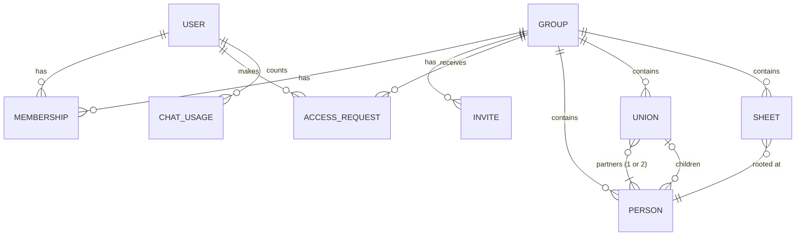

| Collection | Fields | Indexes |
|---|---|---|
| `users`, `sessions`, `accounts`, `verifications` | Managed by Better Auth: email, name, image; sessions; the Google account link; sign-in states | Better Auth's own, created on first write. Ours (`ensureIndexes`): TTL on `sessions.expiresAt` and `verifications.expiresAt` |
| `groups` | `name`, audit fields, `deletedAt?` | — |
| `memberships` | `groupId`, `userId` (Better Auth's `users._id`), `role` (`owner` · `admin` · `maintain` · `view`), `addedBy`, `createdAt` | unique `{groupId, userId}` · `{userId}` |
| `invites` | `groupId`, `email`, `emailNormalized`, `role`, `token`, `invitedBy`, `status` (`pending` · `accepted` · `declined` · `revoked`), `expiresAt`, `createdAt`, `decidedBy?`, `decidedAt?` | unique `{token}` · unique `{groupId, emailNormalized}` where `status = pending` · `{emailNormalized, status}` · `{groupId, status}` |
| `accessRequests` | `groupId` (not always a real group, see F4), `userId`, `email`, `message?`, `status` (`pending` · `approved` · `denied`), `decidedBy?`, `decidedAt?`, `createdAt` | unique `{groupId, userId}`: one per person per group · `{groupId, status}` · `{userId, status}` |
| `persons` | `groupId`, `name`, `gender` (`male` · `female`), `birthYear?`, `deathYear?`, `photoId?`, `notes?`, audit fields, `deletedAt?` | `{groupId}` |
| `unions` | `groupId`, `partnerIds` (1 or 2), `status` (`married` · `divorced`), `childIds`, audit fields, `deletedAt?` | `{groupId}` · `{groupId, partnerIds}` · `{groupId, childIds}` |
| `sheets` | `groupId`, `title`, `rootPersonId`, `pinned`, `order`, `extraPersonIds`, `hideChildrenOf?` (one of the root's couples, [§6](#6-sheets-views-not-copies)), `deletedAt?`, audit fields | `{groupId}` |
| `chatUsage` | `userId`, `day` (`YYYY-MM-DD`, UTC), `count`, `expiresAt` | unique `{userId, day}` · TTL on `expiresAt` (30 days) |

Notes:
- Audit fields are `createdBy`, `createdAt`, `updatedBy` and `updatedAt`.
- A **union** is a couple: the heart in the sample. A union with one partner is a single parent. A person is a child of at most one union. Unions mirror GEDCOM family (`FAM`) records, so GEDCOM import and export map directly.
- `photoId` is the Cloudinary public ID, not a URL. URLs are built when the page renders, with the size and face crop needed.
- Deleting is a soft delete: `deletedAt` hides the record and Undo clears it.
- `groups`, `memberships`, `invites` and `accessRequests` are our own collections, not Better Auth's organization plugin (decided in step 5, [§15](#15-open-questions) question 3).
- References between records are `ObjectId`s. Audit fields (`createdBy`, `updatedBy`, `addedBy`) hold the acting user's id as a string.
- Deleting a group is a soft delete: `deletedAt` hides it from everyone, members included, and its people, couples and sheets stay in the database.
- Better Auth's collection names are plural (`usePlural: true`) to match the others, and user ids are `ObjectId`s like every other record. Renaming the collections later would mean moving data.
- The TTL indexes let MongoDB delete expired sessions and sign-in states, so they don't fill the 512 MB cluster. Better Auth's own indexes aren't repeated in `ensureIndexes`: the same keys under another index name fail.

## 6. Sheets: views, not copies

A sheet stores only a root person, a list of extra people and, optionally, one of the root's couples whose children it leaves out. What it shows is computed every time it is drawn:

1. **Ancestors:** walk up from the root through both parents, as far as the data goes.
2. **Blood relatives:** walk down from every ancestor found, and from the root, to all descendants. This brings in siblings, aunts and uncles, cousins, and the root's own children and grandchildren. The exception: a sheet with `hideChildrenOf` doesn't walk into that couple's children (and so not their families). A mother's own sheet uses it, so it shows her side of the family while her children with the father stay on his side (an owner request after step 11). Children from another couple of hers still show.
3. **Partners:** add the partners of everyone found, including ex-partners. Partners' own parents are **not** followed; they belong on the partner's own sheet.
4. **Extras:** add the sheet's `extraPersonIds` ("show X in this sheet"). They connect to whoever they are related to on the sheet.

Worked example using the people in the sample image (everyone is stored once in one group):

- **Cruz sheet**, rooted at Alexander Cruz: ancestors Timothy Cruz and Amy Harolds, all of their descendants (Jake, Olivia and Timothy Cruz and everyone below them), and those people's partners, such as Jerry Willow, Taylor Humes, Arjun Patel and Emma Young. Jerry Willow's parents (Cynthia Willow and Fred Lambert) are not shown.
- **Jerry Willow's sheet**, an in-law sheet rooted at Jerry: Cynthia Willow and Fred Lambert, any siblings and cousins on that side, and Jerry's descendants. Those are the same Jake, Olivia and Timothy Cruz records as on the Cruz sheet.
- To reproduce the sample image exactly, with both families on one sheet, add Cynthia Willow, Fred Lambert, Margaret Yap and Nick Young as extras on the Cruz sheet.

What follows from this:
- A grandchild added once appears on every sheet that reaches them. There is nothing to sync.
- "A married into B" creates a new sheet rooted at the newcomer ([F7](#f7-ai-chat-priya-married-into-our-family)).
- Deleting a sheet never deletes people. A deleted sheet is kept with `deletedAt` (like people and groups) and is gone for everyone. Pinned sheets (the father's and mother's start pinned) can't be deleted until unpinned, nor can a group's last sheet.

## 7. Tree rendering and auto-layout

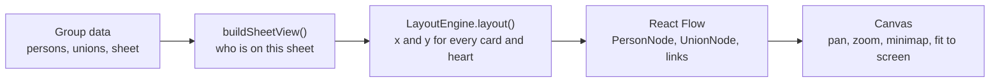

- These steps run in the browser, so after any edit the whole tree is laid out again straight away. That is the "auto adjust" requirement. Layout takes about 30 ms for 100 people and about 250 ms for 300.
- The layout engine sits behind an interface (`src/tree/layout/`), so it can be replaced without touching the canvas. It is async because ELK.js only offers an async API:

```ts
interface LayoutEngine {
  layout(view: SheetView): Promise<{
    persons: { id: string; x: number; y: number }[]; // top-left of each card
    unions: { id: string; x: number; y: number }[]; // heart centre (a single parent: bottom of the card)
    links: { from: string; to: string; kind: "partner" | "child" }[];
    width: number;
    height: number;
  }>;
}
```

**Engine: ELK.js `layered`** (decided in step 2). relatives-tree was tried and rejected: it only draws the root's own relatives, so it dropped the in-law parents, and it separated Steve Cruz from his ex-partner. How the ELK adapter works:
- Partners are grouped into **blocks** drawn side by side: a couple, or a chain such as ex-partner – person – partner. Each block is one ELK node, so partners can never be pulled apart.
- Each block has fixed connection points: one under each heart, one above each person whose parents are on the sheet. ELK then arranges the blocks in generation rows and avoids crossing lines.
- Hearts are placed from the final card positions by a shared helper, the same way for every engine.
- **Sibling order:** avoiding crossing lines comes first, as in the sample image. Siblings with no family of their own below them are then re-packed eldest first, left to right. Siblings with families of their own keep the crossing-free position, so they may not be in birth order.
- Node placement is `NETWORK_SIMPLEX`, which centres parents over their children. `BRANDES_KOEPF` is about 35% faster but hangs each family off one child, so it looks lopsided.

Card design, from Features.md and the sample:
- Round photo using a Cloudinary face crop (`c_thumb,g_face`, 168 px for the 84 px circle), or initials when there is no photo or it doesn't load. A plain ``: Cloudinary resizes, and `next/image` would use Vercel's image quota.
- Border: light blue for male, light pink for female.
- Name, then years. Living people show `1985`; people who have died show `1945 – 2022`. Unknown years are left out.
- Partners side by side with ♥ between them (a broken heart if divorced). Children hang from the heart, eldest first where that adds no crossing lines (see Sibling order above).
- A sheet picture (PNG/PDF) is captured from the canvas in the browser.
- Hide photos (added after step 11): the eye button at the end of the sheet tabs makes every card, the person panel and so the picture show initials instead of photos, for sharing without faces. A view setting only: nothing is saved, it's for everyone, and it lasts until the next visit.
- Day and night themes (added between steps 8 and 9): the whole app, the canvas included, follows the device's setting unless the user picks Day or Night with the switch in the header (Follow device goes back). At night the canvas uses React Flow's dark colours, names turn light, and the blue and pink rings stay.
- For Maintain and up, each card and heart is also a button that opens its panel (F6). The click handlers and the selection reach the cards through a React context, so selecting someone doesn't lay the sheet out again. Without them (the dev pages, and Viewers' edit controls) the canvas is read-only.

## 8. Permissions

| What they can do | View | Maintain | Admin | Owner |
|---|:-:|:-:|:-:|:-:|
| See trees, people and photos; ask the AI chat questions | ✓ | ✓ | ✓ | ✓ |
| Export a picture of a sheet (PNG/PDF) | ✓ | ✓ | ✓ | ✓ |
| Add, edit and delete people, photos and sheets; confirm AI changes | | ✓ | ✓ | ✓ |
| Import; export full data (JSON/GEDCOM) | | ✓ | ✓ | ✓ |
| Invite and remove members, change roles (up to Admin), handle access requests | | | ✓ | ✓ |
| Delete the group, transfer ownership | | | | ✓ |

The table lives in `src/server/roles.ts` as `MIN_ROLE` (the lowest role for each action), and a unit test checks every cell. Every server action, API route and data load starts with the same check (`src/server/permissions.ts`):

```ts
export async function requireRole(groupId: string, min: Role) {
  const user = await requireUser(); // not signed in -> redirect to sign-in
  // roleInGroup: the membership and the group (not deleted), read from the database every time.
  // Malformed id, no such group, deleted group, not a member, role too low: all the same NoAccessError.
  const { role, group } = await roleInGroup(db, groupId, user.id, min);
  return { user, role, group };
}
```

Pages catch `NoAccessError` and show the same "You don't have access to this family tree" page for every case. Server actions return an error message instead ("You don't have permission to change this tree" for edits). `roleInGroup` (in `repositories/groups.ts`) is the database part of the check, so database tests can call it directly.

Rules:
- Call `requireRole` in every server action, API route and data load, not only in `layout.tsx`. Next.js layouts don't re-run on every navigation, and server actions can be called directly. A layout that loads data checks for itself (the sheets layout does); a page never relies on a layout's check.
- Repository functions require a `groupId`, so no query can read across groups.
- The role is never stored in the session. Removing someone takes effect on their next request.
- "No access" looks the same whether or not the group exists, so tree URLs can't be used to probe for groups.
- Only Admins and the Owner grant access, through invites or access requests. Admins can grant up to Admin, and change or remove anyone except the Owner, other Admins included. The Owner can't be removed or demoted, and only the Owner can transfer ownership (to any member; they become an Admin) or delete the group. Everyone but the Owner can leave. These rules are pure functions in `members-rules.ts`; the repository functions check the actor's role themselves (decided in step 8).
- Only Admins and the Owner see the member list, because it shows email addresses.
- The AI chat receives only the tools the user's role allows.

## 9. Flows

### F1. Sign in (and first sign-up)

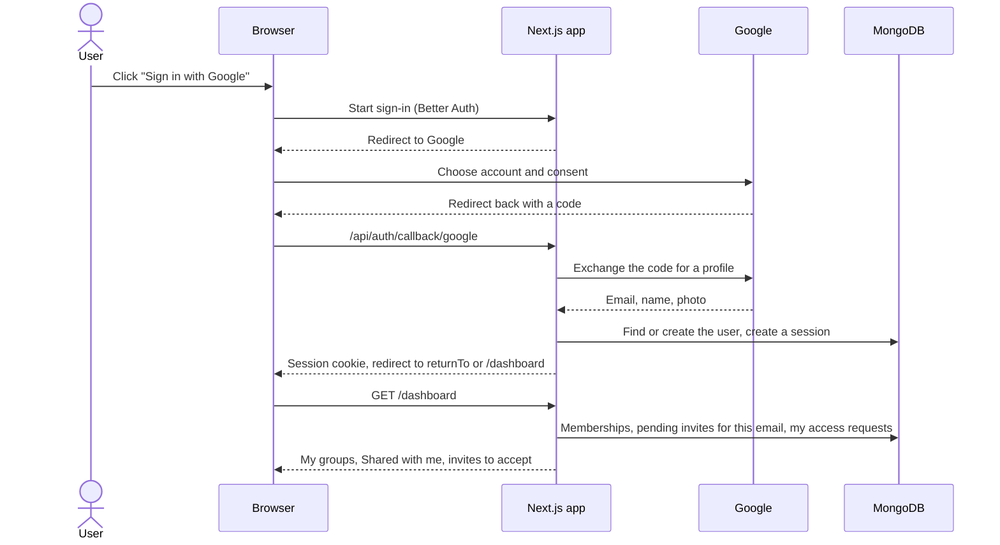

- A new user sees an empty dashboard with "Create a family group", plus any invites already waiting for their email.
- `returnTo` takes people back to the tree link they originally opened ([F4](#f4-request-access-from-a-tree-link)). `src/proxy.ts` sends a signed-out visitor to `/?returnTo=<path and query>` with a real 307. It only checks that a session cookie is present (no database read), denies by default, and never redirects *because* a cookie is present, so a stale cookie can't cause a loop. Pages, server actions and routes still check the session themselves ([§8](#8-permissions)).
- `returnTo` must be a path on this site (`/…`, but not `//…` or `/\…`). Anything else becomes `/dashboard`. A failed sign-in (cancelled, or expired) comes back to `/` with a plain message, keeping `returnTo`.
- Google shows its account chooser every time (`prompt: "select_account"`), so a shared family computer can switch accounts. A sign-in is refused if Google hasn't verified the email address, because invites are matched by email (F3).
- Sessions last 30 days and are extended while in use. Server Components can't write cookies, so server code reads the session without extending it. The user menu's `/api/auth/get-session` call extends it instead.

### F2. Create a group with Father's and Mother's sheets

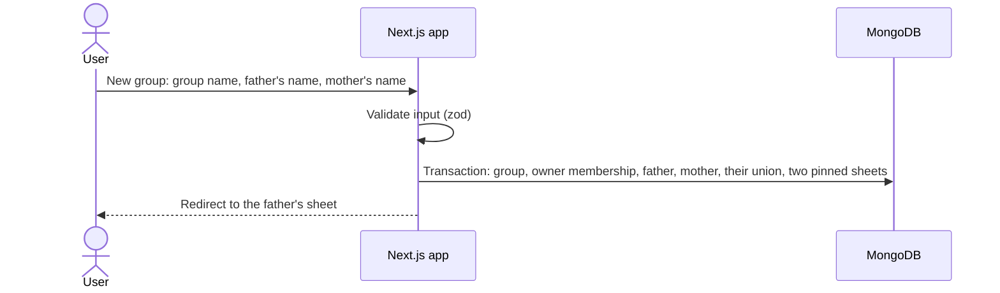

- The pinned sheets are "<Father>'s family", rooted at the father, and "<Mother>'s family", rooted at the mother. The mother's sheet leaves out the couple's children (`hideChildrenOf`, [§6](#6-sheets-views-not-copies)), so it shows her side of the family; the children are on the father's (an owner request after step 11, for groups created from then on).
- The user can add themselves as the couple's child in the same step.
- One transaction: `createGroup` (`src/server/repositories/groups.ts`) inserts the group and the owner membership, then runs the family's operations through the same planner and writes as `applyOperations` (`applyInTransaction`). If any operation is invalid, nothing is saved, not even the group.
- A group link (`/g/{groupId}`) opens the first pinned sheet. The redirect is streamed (it happens inside `<Suspense>`), not a 307.
- Server actions that change a group call `groupChanged()`, which revalidates the dashboard and the group's pages. Without it, Back or a link showed pages the browser had kept from before the change (found in step 5).

### F3. Invite someone

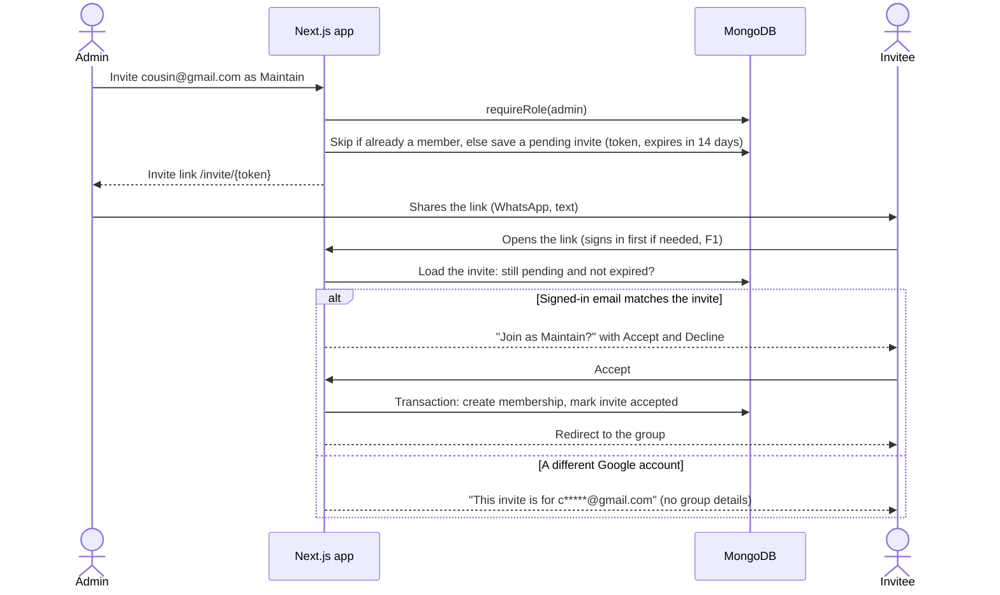

- Invites also appear on the invitee's dashboard, and on the no-access page of the group's tree links, so the link is optional.
- Emails are compared after normalizing: lowercase, and for gmail.com (and googlemail.com) dots and `+tags` are ignored.
- Inviting an address that already has a pending invite refreshes it (role and expiry) and keeps its link. Inviting a member is refused.
- Admins can revoke a pending invite. Revoked, expired, declined and used links all show the same "isn't valid any more" page.
- The token is stored as it is, so Admins can copy a pending invite's link again; on its own it grants nothing, because the signed-in email must match. Links are built in the browser from the page's address, so previews give preview links.
- Accepting also approves the person's pending access request to the group, in the same transaction.

### F4. Request access from a tree link

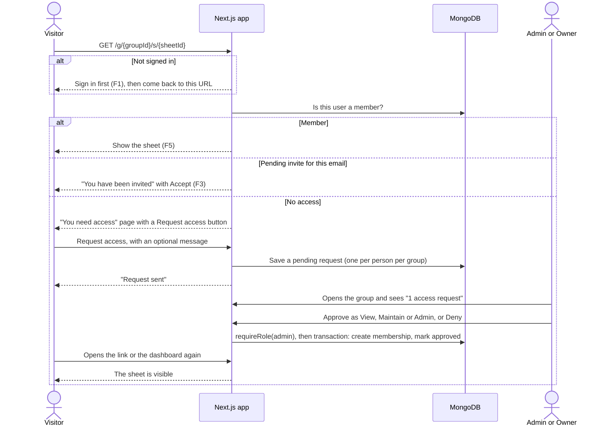

- The "You need access" page shows nothing about the group. It looks the same for a group that doesn't exist: a request for one is kept like a real one and simply stays pending (decided in step 8), so neither the page nor the dashboard shows which groups exist. A person can have at most 20 pending requests. A malformed id can't be a group; it gets the same answer and nothing is saved.
- The requester sees pending and declined requests on their dashboard, without the group's name (they aren't a member). Approved ones show up as the group under Shared with me.
- After a denial they can't ask again; an Admin can still invite them. Someone approved and later removed can ask again.
- Admins and the Owner see the number of pending requests on the group's Members link and on its dashboard row. Approving also marks pending invites for that email accepted.

### F5. Open a sheet

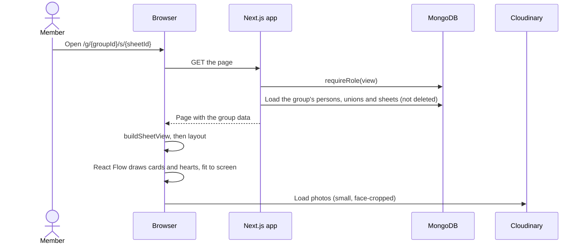

- The whole group's data is loaded once (fine up to a few thousand people), so switching sheet tabs is instant. A tab changes the URL with `history.pushState`, which Next.js's router follows, and the server isn't asked again.
- Tabs: pinned sheets first (Father's, then Mother's), then the rest in their saved order.
- The sheets are drawn by the layout `g/[groupId]/s/layout.tsx`, not the `[sheetId]` page, so they stay mounted while tabs change `[sheetId]`. Otherwise the next save's refresh would render a new page and close any open panel. An unknown sheet id shows the first sheet and corrects the address bar.

### F6. Edit the tree by hand

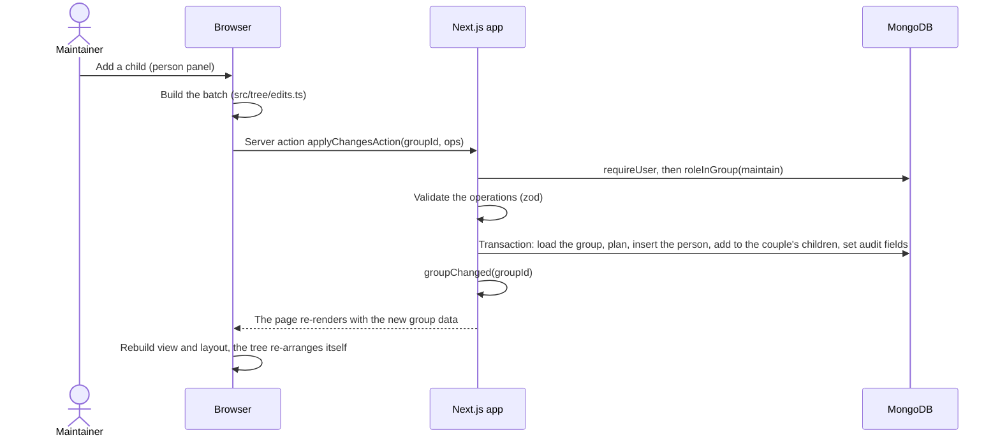

- The same `applyOperations` handles AI proposals ([F7](#f7-ai-chat-priya-married-into-our-family)) and imports ([F10](#f10-import)).
- Clicking a card opens the person panel: details for everyone, and for Maintain and up Edit details, Add parents (or "Add the other parent"; with "Create their own sheet" for the mother, unchecked by default: a sheet for her side of the family, without her children with the father), Add partner (with "Create their own sheet", checked by default), Add child, Show on another sheet and Delete. Clicking a heart opens the couple panel: Married or Divorced, and Add child.
- The tabs have "+ New sheet" and a menu to rename, pin, move and delete the current tab (buttons, not drag-and-drop). Renaming a person renames their sheets that still have the title they were given, "<Name>'s family"; a title of your own stays.
- Each form becomes one batch, so it's applied completely or not at all. Form errors show in the panel; the server's reason shows above the canvas.
- Delete is a soft delete with a 10-second Undo. A sheet's root can't be deleted: delete the sheet first (as for a partner who married in). Deleted people count as absent ([§10](#10-ai-chat-design)), so after deleting someone's parents, new ones can be added.
- Viewers get the panels without any edit controls; the server action is the real check.

### F7. AI chat: "Priya married into our family"

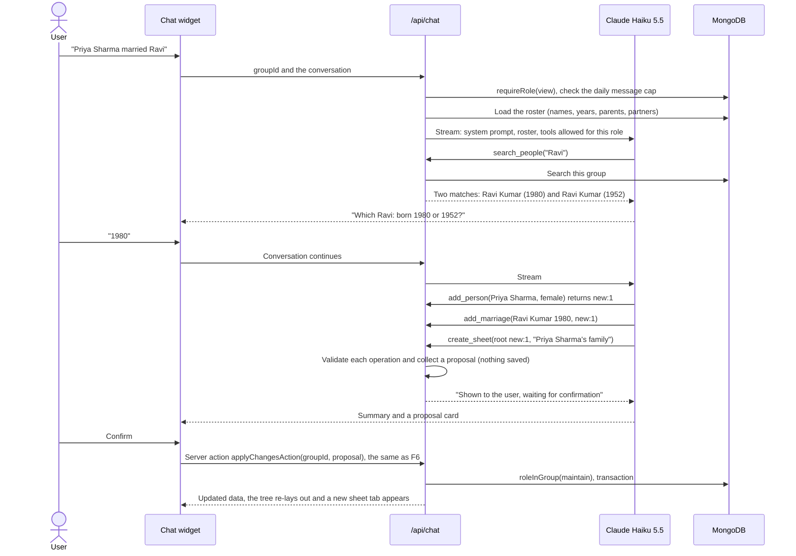

- A Viewer's chat only has the read tools. Asking it for a change gets "you have view-only access".
- The proposal card lists the changes in plain words. Confirm applies all of them or none.
- As built (step 9): "Ask AI" sits at the end of the sheet tabs and opens the assistant beside the tree; the conversation stays when the panel is closed, until New chat or a reload. The family list goes to the model once, after the first question, and after Confirm or Discard the next request carries a note with the new ids (§10). The answer streams as JSON lines: text, "Looking up Ravi…", the growing proposal, and the finished turn for the browser to keep.

### F8. Upload a photo

```mermaid
sequenceDiagram
    actor M as Maintainer
    participant B as Browser
    participant App as Next.js app
    participant CL as Cloudinary
    participant DB as MongoDB
    M->>B: Choose a photo for a person
    B->>B: Check it: JPEG, PNG, WebP or HEIC, up to 10 MB
    B->>App: Server action signPhotoUploadAction(groupId)
    App->>DB: requireRole(maintain)
    App-->>B: Signed upload to groups/{groupId}/{random id}, at most 1600 px
    B->>CL: Upload the file directly
    CL-->>B: Public ID
    B->>App: applyChangesAction([setPhoto(personId, publicId)])
    App->>DB: requireRole(maintain); the planner checks the ID is inside groups/{groupId}/; save photoId
    App-->>B: Saved; the sheets show the new photo
    App->>CL: After the response: delete the replaced photo (if nobody else uses it)
    B->>CL: Display through a face-cropped URL (c_thumb, g_face)
```

- Large photos never pass through Vercel, so its request size limit doesn't apply.
- Signing is a server action, the same pattern as every other change (decided in step 7). The server picks the public ID, so the browser can't choose where a photo goes.
- When a photo is replaced or removed, the old one is deleted from Cloudinary to stay within the free tier, unless another person in the group still uses it. Deleted people count, so Undo brings their photo back. Deleting happens after the response (`after()`); a failure is logged and the save stands.
- Remove photo asks for confirmation, because the photo is deleted and there's no Undo.
- Uploads are tagged with the database name, so local and preview photos can be told apart in Cloudinary's Media Library.

### F9. Export

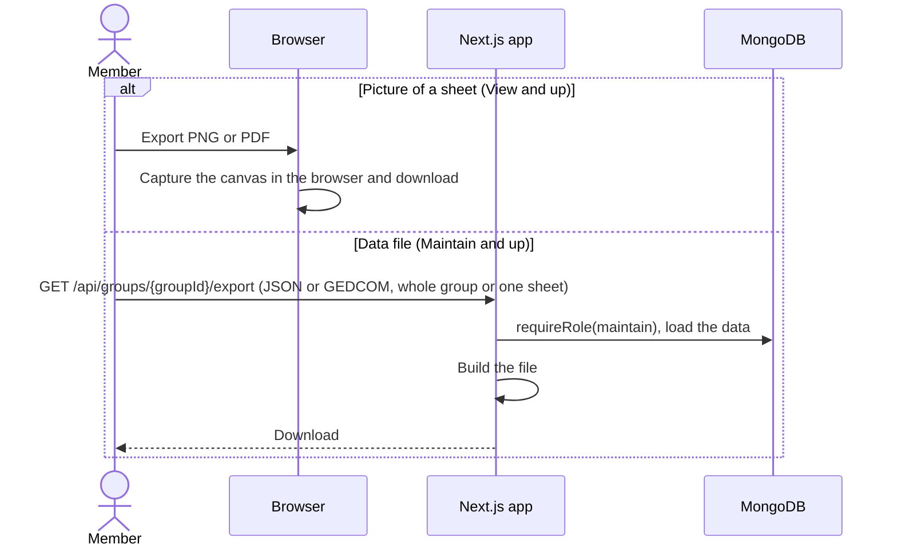

- JSON is lossless and can be re-imported. GEDCOM (5.5.1, which Ancestry, FamilySearch and MyHeritage read) maps persons to `INDI` records and unions to `FAM` records; a same-sex couple gets two `HUSB` or two `WIFE` lines, and sheets aren't exported.
- As built (step 10): an **Export** menu at the end of the sheet tabs. The picture is the whole sheet whatever the zoom, captured with `html-to-image` in the day colours on white (decided in step 10) at twice the resolution (at most 8,000 px). "Print or save as PDF" prints that picture from a hidden frame; the browser's dialog makes the PDF (no PDF library).
- Exporting one sheet exports exactly the people that sheet shows ([§6](#6-sheets-views-not-copies)).

### F10. Import

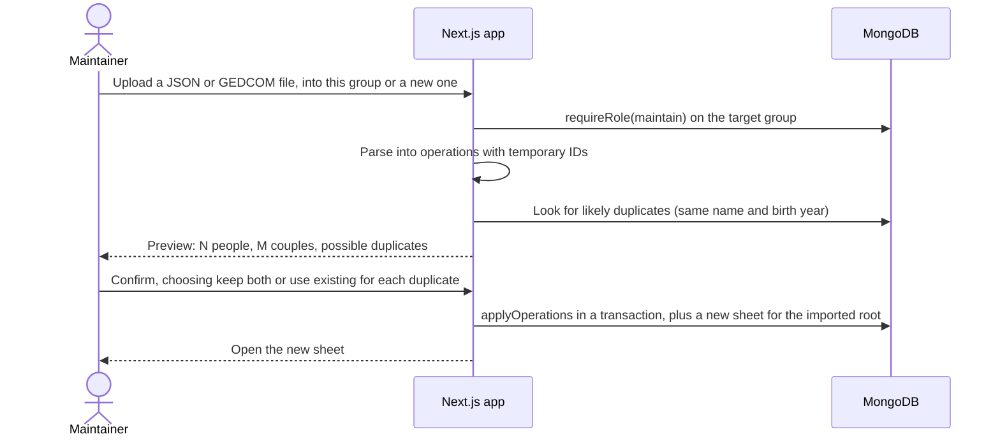

- Importing into a new group creates the group first ([F2](#f2-create-a-group-with-fathers-and-mothers-sheets)), with the importer as Owner.
- As built (step 10): **every file is read in the browser** (decided in step 10), so there is no upload limit and no import route. The preview (`ImportPanel`) shows the counts, what isn't kept, repairs, possible duplicates (same name, ignoring case and accents, and the same birth year; "Use existing" by default, or "Keep both"), people with no recorded sex (male or female must be chosen) and whose sheet opens. The resulting operations go to `applyChangesAction` (into this group) or `importGroupAction` (a new group, through `createGroup`), and are checked like any batch.
- At most 2,000 people per file; the operations schema allows 20,000 operations and 2,000 new people per batch, and server actions take up to 4 MB.
- GEDCOM 5.5.1 keeps names, sex, birth and death years, couples, children and divorces. Places, full dates, notes, sources and media aren't kept, and the preview says so. A family without partners is skipped, a child in two families stays with the first (or the birth family), and a couple listed twice is joined, each with a warning.
- Photos come in only when a JSON file goes back into the group it was exported from (a photo lives in its group's Cloudinary folder).

### F11. Deploy

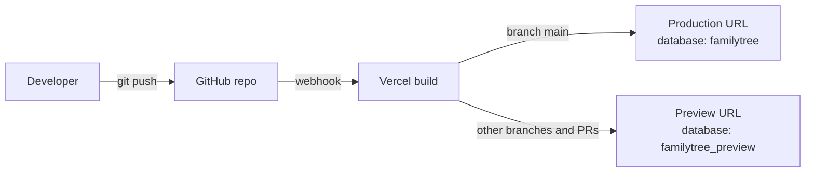

### F12. Nightly backup and restore

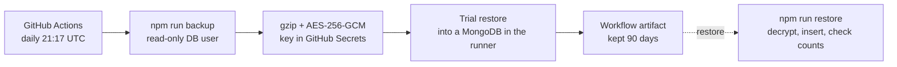

- `npm run backup` (step 11) reads every collection of `familytree` except `sessions` and `verifications` (sign-in leftovers that expire anyway) with a read-only database user, and writes one file: a header with each collection's count and indexes, then one line per document in canonical Extended JSON, so ids, dates and number types come back exactly. Decided in step 11 instead of `mongodump`: no extra tools on GitHub or the owner's Mac, and `npm run test:db` tests the same code.
- Each run restores its own file into a MongoDB started inside the runner before keeping it, so every backup is known to restore, without the workflow having write access to Atlas.
- `npm run restore -- <file> <database>` refuses a database that already has records unless given `--replace`; `--check` restores into a throwaway database, compares the counts, and empties it. It asks for the key rather than taking it on the command line.
- The backup is encrypted (AES-256-GCM, which also refuses a damaged or altered file) so it stays private even if the repository is ever made public. The key is a GitHub secret and is also kept in the owner's password manager: without it no backup can be read.
- Photos are not in this backup; they live in Cloudinary.

## 10. AI chat design

| Tool | What it does | Kind | Minimum role |
|---|---|---|---|
| `search_people` | Find people in this group by name and years | read | View |
| `get_person` | One person's parents, partners, children and sheets | read | View |
| `add_person` | New person; returns a temporary ID such as `new:1` | proposal | Maintain |
| `update_person` | Change name, gender or years (for example, record a death year) | proposal | Maintain |
| `add_marriage` | Join two people as a couple, married or divorced | proposal | Maintain |
| `add_child` | Add a child to a couple or a single parent | proposal | Maintain |
| `create_sheet` | New sheet rooted at a person (in-laws) | proposal | Maintain |
| `add_to_sheet` | Show a person on a sheet | proposal | Maintain |

- Proposal tools save nothing. Each one adds an operation to the pending proposal and returns a temporary ID that later calls can refer to.
- There is no delete tool. Deleting is only done in the UI.
- On Confirm, the proposal's operations go through `applyOperations`, where they are validated and permission-checked again. A tampered proposal can do nothing beyond what the user could already do by hand.

Operations shared by manual edits, AI proposals and imports:

```ts
type Ref = string; // an existing id, or a temporary id like "new:1" created earlier in the same batch

type Operation =
  | { op: "createPerson"; tempId: string; name: string; gender: "male" | "female"; birthYear?: number; deathYear?: number }
  | { op: "updatePerson"; personId: Ref; set: { name?: string; gender?: "male" | "female"; birthYear?: number | null; deathYear?: number | null } }
  | { op: "createUnion"; tempId?: string; partnerIds: [Ref] | [Ref, Ref]; status: "married" | "divorced" }
  | { op: "updateUnion"; unionId: Ref; status: "married" | "divorced" }
  | { op: "addChild"; unionId: Ref; childId: Ref }
  | { op: "createSheet"; tempId?: string; title: string; rootPersonId: Ref; pinned?: boolean; hideChildrenOf?: Ref } // hideChildrenOf: one of the root's couples (§6)
  | { op: "addToSheet"; sheetId: Ref; personId: Ref }
  | { op: "setPhoto"; personId: Ref; photoId: string | null } // a public ID in groups/{groupId}/; null removes it
  | { op: "deletePerson"; personId: Ref } // UI only, never offered to the AI (soft delete)
  | { op: "restorePerson"; personId: Ref } // UI only: Undo for deletePerson
  | { op: "addPartner"; unionId: Ref; personId: Ref } // UI only: a single parent's partner (the other parent)
  | { op: "updateSheet"; sheetId: Ref; set: { title?: string; pinned?: boolean } } // UI only
  | { op: "deleteSheet"; sheetId: Ref } // UI only (soft delete): never a pinned sheet or the last one
  | { op: "reorderSheets"; sheetIds: Ref[] }; // UI only: every sheet of the group, in tab order
```

How `applyOperations` works (`src/server/operations/`, built in step 3):
- The batch is validated with zod. Then, inside one transaction, the group's records are loaded and a pure planner (`planOperations`) checks every operation against them before anything is written. Errors name the failing change ("Change 3: …").
- Rules: references must exist in the same group; a couple has 1–2 different people and can't be created twice; a person has at most one set of parents and can't become their own ancestor; a death year can't be before the birth year. Repeating `addChild` or `addToSheet` changes nothing.
- Added in step 6: `addPartner` only for a couple with one partner, and the new partner can't be one of the couple's descendants; `reorderSheets` must list every sheet exactly once; a person who is a sheet's root can't be deleted (the sheet would be empty). Tabs show pinned sheets first, then the saved order.
- Added in step 7: `setPhoto`'s photo must be in the group's folder (`groups/{groupId}/`). The plan lists the photos a batch replaced or removed that nobody in the group uses any more (`unusedPhotoIds`), and `applyChangesAction` deletes them from Cloudinary once the batch is committed.
- Deleted people stay in their couples (so Undo restores them fully) but count as absent, exactly as the browser shows them (`toGroupTree`): a couple whose partners are all deleted isn't anyone's parents, so its children can be given new parents (they leave the old couple, so restoring the old parents can't give them two sets); and a new partner can take a deleted partner's place (`addPartner`).
- All or nothing: one invalid operation rejects the batch. Concurrent edits are safe: on a write conflict MongoDB retries the transaction, which re-reads the group.
- Added after step 11 (owner requests): `createSheet`'s `hideChildrenOf` must be a couple the root is in; `deleteSheet` refuses a pinned sheet and the group's last sheet; deleted sheets are treated as absent (not found, not counted by `reorderSheets`, and no longer stop their root being deleted).
- `parseOperations` and `applyInTransaction` let a caller write more in the same transaction: `createGroup` adds the group and its owner membership (F2).
- `OperationError` carries the failing change's index and its `reason`; a form shows the reason as a sentence.

Model and prompt (built in step 9):
- The model comes from `CHAT_MODEL` (`claude-haiku-5-5`) through the official `@anthropic-ai/sdk`, streamed. Adaptive thinking (the model's default, not shown), effort `medium`, no temperature (Claude Haiku 5.5 refuses one), `max_tokens` 4096, and at most 8 tool rounds per message.
- Tools are `strict`, so inputs always match their schemas; the handlers check them again. Read tools look at the group's current data; each proposal tool's operation is dry-run with the planner (`planOperations`) against the group's records, so the model hears at once about anything `applyOperations` would refuse, with the reason.
- **The conversation is append-only.** Claude Haiku 5.5's thinking stays valid only while everything sent before it is unchanged. So the system prompt is fixed (instructions only, the same for everyone, cached). The user's role and the group's people (id, name, years, parents, partners; up to 300, beyond that the model uses `search_people`) and sheets arrive as one operator (`role: "system"`) message after the first question, and confirmed or discarded proposals as a short note after the next question. Nothing earlier is ever edited, which also keeps the prompt cache valid.
- The conversation lives in the browser for the visit (decided in step 9) and comes back with each message, checked for shape and size (60 messages). The model's thinking blocks go back unchanged; the API refuses altered ones.
- Names and notes are written by users, so they are treated as data, not instructions. Even a malicious name can't cause harm, because changes need a person's click and are limited by their role. A person who alters their own conversation only affects their own chat: the tools are chosen on the server by role, and Confirm goes through `applyChangesAction`.
- Cost guard: a per-user daily message cap (`CHAT_DAILY_LIMIT`, 50, counted atomically in `chatUsage`), plus a monthly spend limit set in the Anthropic Console. A 36-person family's list is about 1,500 tokens, roughly $0.0002 per chat.
- Refusals (`stop_reason: "refusal"`; Claude Haiku 5.5 has no fallback model) give "I can't help with that"; rate limits and other API errors give a plain message, with details in the server log.
- The key is `CHAT_API_KEY`, not `ANTHROPIC_API_KEY`: a Claude Code session that loads `.env.local` would pick up the standard name for itself. The client is always given its key and address, because the SDK otherwise reads `ANTHROPIC_*` variables, which processes started from Claude Code inherit.

## 11. Security and privacy

- **Sign-in:** Google only. No passwords are stored. Only Google-verified email addresses are accepted. Sessions are httpOnly cookies backed by the `sessions` collection.
- **Test sign-in:** e2e tests sign in through a Playwright fixture that writes users and sessions straight into the test database (Better Auth's `testUtils`). The app has no test-login route, and ESLint forbids importing `testUtils` under `src/`.
- **Permissions:** checked on the server for every request ([§8](#8-permissions)). `src/proxy.ts` sends signed-out visitors to sign in (deny by default), but it only looks for a session cookie; it's a convenience, not the check.
- **Sign-in limits:** Better Auth rate-limits sign-in attempts in production (3 per 10 seconds per IP).
- **Group isolation:** `groupId` is on every record and in every query.
- **Photos:** only Maintain and up get an upload signature, for a random public ID the server picks under `groups/{groupId}/`. The planner refuses a photo from outside the group's folder, so a member can't attach another group's photo. Photo URLs are public but unguessable; if stronger privacy is needed later, switch to Cloudinary's signed delivery.
- **Secrets:** only in Vercel environment variables and GitHub Secrets, never committed. `.env.local` is git-ignored. Keep local settings there only: Next.js also loads a `.env` file as a fallback.
- **Database network access:** Vercel and GitHub Actions use changing IP addresses, so Atlas must allow connections from anywhere (`0.0.0.0/0`). This is offset by a separate database user per purpose (the app gets read/write on its own database, the backup gets read-only) and long random passwords.
- **Preview deployments** use their own database, so testing can't damage real data.
- **Backups** are encrypted (F12), made with a read-only user, and leave out sessions.
- **AI chat:** tools filtered by role, confirmation by a person before any change, and a daily cap.
- **Security headers** (step 11, `src/server/security-headers.ts`) on every response:
  - **Content Security Policy:** scripts, styles, fonts and connections only from the site itself; images also from `res.cloudinary.com` and `data:`/`blob:`; connections also to `api.cloudinary.com` (uploads) and `res.cloudinary.com` (the picture export); no plugins, no framing by other sites, base URLs and forms only to the site.
  - **Inline scripts are allowed:** Next.js writes each page's data into inline scripts, and nonces would need every page drawn per request, which partial prerendering (`cacheComponents`) doesn't allow (decided in step 11). React escapes everything people type, and the app has no raw HTML apart from the fixed theme script.
  - **The others:** HSTS (two years), `nosniff`, `X-Frame-Options: DENY`, `Referrer-Policy: strict-origin-when-cross-origin` (invite links never leave as referrers), a `Permissions-Policy` without camera, microphone or location, `Cross-Origin-Opener-Policy: same-origin`, and no `X-Powered-By`.
  - **Tests:** every e2e test fails if the browser reports a policy violation, and the production smoke test checks the headers on the live site after each deployment.
- **Inputs from the browser** are treated as anything at all: a server action can be called directly with any arguments. Ids go through `toObjectId` and invite tokens through a format check before any query, so an object like `{ $ne: "" }` never reaches MongoDB (the invite token was found unchecked in step 11's review). Everything else is checked by zod, with lengths bounded.
- **Every server action and route handler checks the caller,** and a unit test (`test/server-checks.test.ts`) fails if a new one doesn't call `requireUser`, `requireRole` or `getUser`.
- **Google's tokens** are stored encrypted with `BETTER_AUTH_SECRET` (Better Auth's `encryptOAuthTokens`); the app never uses them.
- **Dependencies:** GitHub's Dependabot alerts email the owner about known vulnerabilities. In step 11, `npm audit` found none in what the site ships; a high-severity advisory in `braces`, used only by ESLint's Next.js config, is accepted (it's never shipped, and the only fix npm offers would downgrade ESLint's Next.js config to version 14).
- **Accepted risks** (step 11's review):
  - Anyone with a Google account can sign in and create groups, and import up to 2,000 people at a time, so a stranger could fill the free cluster's 512 MB; each account also gets 50 chat messages a day. The Anthropic Console's monthly spend limit caps the chat's cost. See §15.
  - Server actions have no rate limit of their own. Trusted members (Maintain and up) could upload many photos.
  - The chat's conversation comes back from the browser, so a person can alter their own history (up to 400,000 characters per request). It only affects their own chat: proposals still need their Confirm and the server's checks.
  - Better Auth's sign-in rate limit keeps its counts in memory, so on Vercel each server instance counts separately.

## 12. Environments

| Environment | Trigger | URL | Database |
|---|---|---|---|
| Local | `npm run dev` | `http://localhost:3000` | `familytree_dev` |
| Preview | Push to any branch other than `main`, or a PR | A `*.vercel.app` URL per branch | `familytree_preview` |
| Production | Push to `main` | https://family-tree-with-ai.vercel.app | `familytree` |
| End-to-end tests | `npm run test:e2e` (locally and on CI) | `http://localhost:3100` (a production build) | `familytree_test_<time>_e2e`, seeded and removed per run |

- `vercel.json` sets the framework to Next.js, which overrides the Framework Preset in the Vercel dashboard.
- All three databases live in the one free Atlas cluster and share its 512 MB.
- From a laptop far from the cluster, each save takes 1–5 seconds (a transaction plus a re-render), so the e2e tests wait up to 15 seconds per check. On Vercel the functions should run near the cluster: `vercel.json` doesn't set `regions`, so they run in Vercel's default `iad1` (Washington); set it if the cluster is elsewhere.
- Tests use throwaway `familytree_test_<time>_<label>` databases in the same cluster: one per database-test file and one per e2e run. They remove themselves afterwards, and leftovers from crashed runs are cleared after an hour.
- Google only accepts exact redirect URLs, so only two are registered: `http://localhost:3000/api/auth/callback/google` and the production one.
- **Google sign-in on previews** goes through production, using Better Auth's OAuth proxy plugin (decided in step 4):
  - The preview sends Google production's callback URL. Production exchanges the code but creates no user, then hands the encrypted profile back to the preview, which signs in against `familytree_preview`.
  - The handoff is encrypted with `OAUTH_PROXY_SECRET`, the same value in Production and Preview. The databases and `BETTER_AUTH_SECRET` stay separate.
  - It needs production to run the plugin, so the first preview that can sign in with Google is the one after the plugin reaches production (step 5's).
- Each deployment trusts exact origins only: `BETTER_AUTH_URL` locally and in production; on a preview, its own `VERCEL_BRANCH_URL` and `VERCEL_URL`. Never `*.vercel.app`, which would trust anyone's Vercel app.

## 13. Configuration

| Variable | Used by | Notes |
|---|---|---|
| `MONGODB_URI` | App; GitHub Actions (tests) | Database user with read/write only (no admin). CI uses a separate test user, stored as a repo secret |
| `MONGODB_DB` | App | `familytree`, `familytree_preview` or `familytree_dev` |
| `BETTER_AUTH_SECRET` | App | Random, at least 32 bytes. Different in Production and Preview |
| `BETTER_AUTH_URL` | App | Base URL locally and in production. Not set on previews |
| `OAUTH_PROXY_SECRET` | App (Vercel) | Random, at least 32 bytes. The same value in Production and Preview: encrypts the preview sign-in handoff ([§12](#12-environments)) |
| `VERCEL_ENV`, `VERCEL_URL`, `VERCEL_BRANCH_URL`, `VERCEL_PROJECT_PRODUCTION_URL` | App | Set by Vercel ("Automatically expose System Environment Variables") |
| `GOOGLE_CLIENT_ID`, `GOOGLE_CLIENT_SECRET` | App | Google Cloud OAuth client |
| `CLOUDINARY_CLOUD_NAME`, `CLOUDINARY_API_KEY`, `CLOUDINARY_API_SECRET` | App | The same account in Production and Preview. Without them, cards show initials and photo buttons are hidden |
| `CHAT_API_KEY` | App | The Anthropic API key for the chat (not `ANTHROPIC_API_KEY`, see §10). Without it, there is no "Ask AI" |
| `CHAT_MODEL` | App | `claude-haiku-5-5` |
| `CHAT_DAILY_LIMIT` | App | Messages per user per day, for example 50 |
| `MONGODB_BACKUP_URI` | GitHub Actions (`backup.yml`) | A database user with only `read` on `familytree`; the app's cluster address with its own user and password |
| `BACKUP_ENCRYPTION_KEY` | GitHub Actions; `npm run restore` | 32 random bytes in base64 (`openssl rand -base64 32`). A GitHub secret, also kept in the owner's password manager. `npm run restore` asks for it when it isn't set |
| `BACKUP_DB` | `npm run backup` | The database to back up; `familytree` unless set |
| `ENABLE_DEV_PAGES` | Tests only | `1` includes the `/dev/*` pages in a production build (set by `playwright.config.ts`); never on Vercel |
| `E2E_MONGODB_DB`, `E2E_BASE_URL`, `E2E_AUTH_SECRET` | Tests only | Set by `playwright.config.ts` for each run and shared by the web server and the test workers |
| `CHAT_API_URL`, `E2E_MODEL_URL` | Tests only | The e2e stand-in for the Messages API (`e2e/model-stub.mts`); the app defaults to `https://api.anthropic.com` |
| `SMOKE_URL` | Tests only | The site the smoke test checks; production unless set |
| `CLOUDINARY_API_URL`, `E2E_CLOUDINARY_URL` | Tests only | The e2e stand-in for Cloudinary's API (`e2e/cloudinary-stub.mts`); the app defaults to `https://api.cloudinary.com` |

## 14. Limits and when to upgrade

| Resource | Free limit | When it starts to matter | Next step |
|---|---|---|---|
| MongoDB Atlas M0 | 512 MB storage | Hundreds of thousands of people (photos aren't stored here) | A paid Atlas tier |
| Vercel Hobby | Personal, non-commercial use; going over usage limits pauses the site rather than billing | Any commercial use | Vercel Pro |
| Cloudinary | Monthly credits shared by storage, bandwidth and transformations; images up to 10 MB | Tens of thousands of photos or heavy traffic (photos are stored at most 1600 px, and cards load 168 px crops) | A paid plan |
| Claude API | Paid per use | Many active chat users | Daily cap and spend limit already in place |
| Data per page | The whole group is loaded at once | Several thousand people in one group | Load each sheet's people from the server |
| Atlas M0 speed | Shared, throttled cluster | Slow saves from far away; many editors at once | Functions in the cluster's region; a paid tier |

## 15. Open questions

1. ~~**Who approves access requests**~~ **Resolved 2026-10-18:** only Admins and the Owner, the same rule as invites.
2. ~~**Layout engine**~~ **Resolved 2026-10-18 (step 2):** ELK.js. relatives-tree couldn't draw in-law parents ([§7](#7-tree-rendering-and-auto-layout)).
3. ~~**Better Auth organization plugin**~~ **Resolved 2026-10-18 (step 5):** our own `groups`, `memberships` and `invites`. The plugin does allow invites without email, but in 1.7.10 it writes in its own transaction (F2 needs the group, owner membership and family in one), matches invite emails by lowercase only (F3 also ignores gmail dots and `+tags`), allows several owners (§8: exactly one), and adds about 40 HTTP endpoints that change members outside `requireRole`.
4. ~~**Google sign-in on preview deployments**~~ **Resolved 2026-10-18 (step 4):** Better Auth's OAuth proxy plugin, with its own `OAUTH_PROXY_SECRET`. Previews keep their own database and secret, and Google keeps just two redirect URIs ([§12](#12-environments)). Checked working on step 5's preview.
5. **Deleting a sheet, and hiding an extra person from a sheet:** left out of step 6 to keep it small. Deleting a sheet: ~~open~~ **resolved 2026-10-20 (owner request):** a UI-only `deleteSheet` operation, a soft delete; never a pinned sheet or the last one, and never its people ([§6](#6-sheets-views-not-copies)). Hiding an extra person from a sheet is still open.
6. **Photos uploaded but never saved:** if the tab closes mid-way, or the save is refused, the uploaded photo stays in Cloudinary unused. Rare, so left out of step 7. A sweep could later delete photos in a group's folder that no person uses.
7. **Copying photos on import:** photos come in only when a JSON file goes back into its own group. Copying them into another group's Cloudinary folder could come later.
8. ~~**Open sign-up**~~ **Resolved 2026-10-20 (owner):** sign-up stays open to any Google account, an accepted risk (§11). Found in step 11's review: a stranger could create groups and import into them until the free cluster is full, or use their 50 chat messages a day. If that ever happens, the options are a cap on groups (or people) per account, or sign-up by invite only.
