# Family Tree with AI — Architecture

**Status:** design agreed, build in progress · **Requirements:** [Features.txt](Features.txt) · **Build plan:** [BUILD_PLAN.md](BUILD_PLAN.md) · **Last updated:** 2026-10-18

A web app where a family builds its tree together. People are added by hand or by chatting with an AI assistant, laid out automatically in the style of [samples/Sample Family Tree.png](samples/Sample%20Family%20Tree.png), and shared privately with relatives through their Google accounts.


---

## 1. Goals and constraints

| Goal | How the architecture meets it |
|---|---|
| Free to run | Free tiers only: Vercel Hobby, MongoDB Atlas M0, Cloudinary, Google OAuth. Only AI chat usage is paid. |
| Deploys itself | Vercel builds every push: `main` goes to production, other branches get preview URLs. |
| Low maintenance | No servers to manage. One app, one deploy, all services hosted. |
| Google sign-in only | Better Auth with Google as the only provider. |
| Private by default, shared by invite | Groups with roles (View, Maintain, Admin, Owner). Every request is checked on the server. |
| Data independent of code | Data in MongoDB Atlas, photos in Cloudinary. JSON/GEDCOM export and a nightly encrypted backup. |
| Looks like the sample | Round photos, light blue/pink borders, a heart between partners, automatic layout. |

## 2. Key design decisions

1. **One Next.js app is both UI and API.** There is no separate backend to host.
2. **Each person is stored once; sheets are views.** A child added once appears on every sheet that reaches them ([§6](#6-sheets-views-not-copies)).
3. **One write path.** Manual edits, confirmed AI proposals and imports all go through the same `applyOperations` function, with the same validation and permission checks ([§10](#10-ai-chat-design)).
4. **Permissions are checked on the server, on every request, per group.** Every query carries `groupId`, and the user's role is read from the database each time ([§8](#8-permissions)).
5. **The AI proposes; a person confirms.** The AI never writes to the database directly ([F7](#f7-ai-chat-priya-married-into-our-family)).
6. **Photos skip the app server.** The browser uploads straight to Cloudinary using a signature from the app ([F8](#f8-upload-a-photo)).

## 3. Tech stack

| Layer | Choice |
|---|---|
| Language and framework | TypeScript, Next.js (App Router, server components, server actions) |
| UI | Tailwind CSS, shadcn/ui |
| Tree canvas | React Flow (`@xyflow/react`) |
| Auto-layout | ELK.js (`layered`), behind an adapter ([§7](#7-tree-rendering-and-auto-layout)) |
| Sign-in | Better Auth, Google provider only |
| Database | MongoDB Atlas M0, official `mongodb` driver |
| Validation | zod, shared by forms, server actions, AI tool inputs and imports |
| Photos | Cloudinary (signed direct upload, face-aware crops) |
| AI chat | Claude API via `@anthropic-ai/sdk`, model `claude-haiku-5-5`, tool calling, streaming |
| Hosting and CI | Vercel Hobby, GitHub |
| Backups | GitHub Actions (scheduled) |

The reasons behind each choice are recorded in [Features.txt](Features.txt) under DECISIONS.

## 4. Code layout

```
src/
  app/                                   Next.js routes
    page.tsx                             landing + "Sign in with Google"
    dashboard/page.tsx                   My groups · Shared with me · invites · my access requests
    g/[groupId]/
      page.tsx                           redirects to the first pinned sheet
      s/[sheetId]/page.tsx               tree canvas + sheet tabs + AI chat
      members/page.tsx                   members, invites, access requests (Admin and up)
      settings/page.tsx                  rename, transfer ownership, delete (Owner)
    invite/[token]/page.tsx              accept or decline an invite
    dev/tree/                            developer-only pages (404 on Vercel): layout playground; db/ draws the seeded family
    api/
      auth/[...all]/route.ts             Better Auth handler
      chat/route.ts                      AI chat (streaming)
      uploads/sign/route.ts              Cloudinary upload signature
      groups/[groupId]/export/route.ts   JSON / GEDCOM download
      groups/[groupId]/import/route.ts   parse and preview an import
  server/                                server-only code
    db.ts                                MongoDB client, reused across invocations
    auth.ts                              Better Auth configuration
    permissions.ts                       requireUser, requireRole
    repositories/                        data access; every function takes groupId
    operations/                          applyOperations: the single write path
    ai/                                  system prompt, tool definitions, proposal builder
    import-export/                       json.ts, gedcom.ts
  tree/                                  pure functions, run in the browser and in tests
    sheet-view.ts                        which people and unions belong on a sheet
    layout/                              LayoutEngine interface + ELK.js adapter
  components/
    tree/                                FamilyCanvas, PersonNode, UnionNode (heart)
    chat/                                ChatWidget, ProposalCard
    ui/                                  shadcn components
```

## 5. Data model

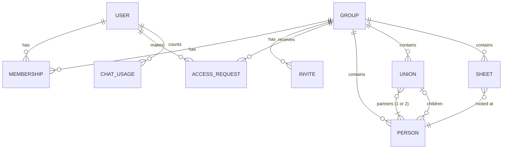

| Collection | Fields | Indexes |
|---|---|---|
| `users`, `sessions`, `accounts` | Managed by Better Auth (email, name, image) | Better Auth's own |
| `groups` | `name`, `createdBy`, `createdAt`, `deletedAt?` | — |
| `memberships` | `groupId`, `userId`, `role` (`owner` · `admin` · `maintain` · `view`), `addedBy`, `createdAt` | unique `{groupId, userId}` · `{userId}` |
| `invites` | `groupId`, `email`, `emailNormalized`, `role`, `token`, `invitedBy`, `status` (`pending` · `accepted` · `declined` · `revoked`), `expiresAt` | unique `{token}` · `{emailNormalized, status}` · `{groupId, status}` |
| `accessRequests` | `groupId`, `userId`, `email`, `message?`, `status` (`pending` · `approved` · `denied`), `decidedBy?`, `decidedAt?`, `createdAt` | unique `{groupId, userId}` where `status = pending` · `{groupId, status}` |
| `persons` | `groupId`, `name`, `gender` (`male` · `female`), `birthYear?`, `deathYear?`, `photoId?`, `notes?`, audit fields, `deletedAt?` | `{groupId}` |
| `unions` | `groupId`, `partnerIds` (1 or 2), `status` (`married` · `divorced`), `childIds`, audit fields, `deletedAt?` | `{groupId}` · `{groupId, partnerIds}` · `{groupId, childIds}` |
| `sheets` | `groupId`, `title`, `rootPersonId`, `pinned`, `order`, `extraPersonIds`, audit fields | `{groupId}` |
| `chatUsage` | `userId`, `day` (`YYYY-MM-DD`), `count` | unique `{userId, day}` |

Notes:
- Audit fields are `createdBy`, `createdAt`, `updatedBy` and `updatedAt`.
- A **union** is a couple: the heart in the sample. A union with one partner is a single parent. A person is a child of at most one union. Unions mirror GEDCOM family (`FAM`) records, so GEDCOM import and export map directly.
- `photoId` is the Cloudinary public ID, not a URL. URLs are built when the page renders, with the size and face crop needed.
- Deleting is a soft delete: `deletedAt` hides the record and Undo clears it.
- If Better Auth's organization plugin is adopted, its tables replace `groups`, `memberships` and `invites`. `accessRequests` stays ours.

## 6. Sheets: views, not copies

A sheet stores only a root person and a list of extra people. What it shows is computed every time it is drawn:

1. **Ancestors:** walk up from the root through both parents, as far as the data goes.
2. **Blood relatives:** walk down from every ancestor found, and from the root, to all descendants. This brings in siblings, aunts and uncles, cousins, and the root's own children and grandchildren.
3. **Partners:** add the partners of everyone found, including ex-partners. Partners' own parents are **not** followed; they belong on the partner's own sheet.
4. **Extras:** add the sheet's `extraPersonIds` ("show X in this sheet"). They connect to whoever they are related to on the sheet.

Worked example using the people in the sample image (everyone is stored once in one group):

- **Cruz sheet**, rooted at Alexander Cruz: ancestors Timothy Cruz and Amy Harolds, all of their descendants (Jake, Olivia and Timothy Cruz and everyone below them), and those people's partners, such as Jerry Willow, Taylor Humes, Arjun Patel and Emma Young. Jerry Willow's parents (Cynthia Willow and Fred Lambert) are not shown.
- **Jerry Willow's sheet**, an in-law sheet rooted at Jerry: Cynthia Willow and Fred Lambert, any siblings and cousins on that side, and Jerry's descendants. Those are the same Jake, Olivia and Timothy Cruz records as on the Cruz sheet.
- To reproduce the sample image exactly, with both families on one sheet, add Cynthia Willow, Fred Lambert, Margaret Yap and Nick Young as extras on the Cruz sheet.

What follows from this:
- A grandchild added once appears on every sheet that reaches them. There is nothing to sync.
- "A married into B" creates a new sheet rooted at the newcomer ([F7](#f7-ai-chat-priya-married-into-our-family)).
- Deleting a sheet never deletes people.

## 7. Tree rendering and auto-layout

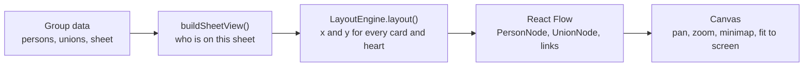

- These steps run in the browser, so after any edit the whole tree is laid out again straight away. That is the "auto adjust" requirement. Layout takes about 30 ms for 100 people and about 250 ms for 300.
- The layout engine sits behind an interface (`src/tree/layout/`), so it can be replaced without touching the canvas. It is async because ELK.js only offers an async API:

```ts
interface LayoutEngine {
  layout(view: SheetView): Promise<{
    persons: { id: string; x: number; y: number }[]; // top-left of each card
    unions: { id: string; x: number; y: number }[]; // heart centre (a single parent: bottom of the card)
    links: { from: string; to: string; kind: "partner" | "child" }[];
    width: number;
    height: number;
  }>;
}
```

**Engine: ELK.js `layered`** (decided in step 2). relatives-tree was tried and rejected: it only draws the root's own relatives, so it dropped the in-law parents, and it separated Steve Cruz from his ex-partner. How the ELK adapter works:
- Partners are grouped into **blocks** drawn side by side: a couple, or a chain such as ex-partner – person – partner. Each block is one ELK node, so partners can never be pulled apart.
- Each block has fixed connection points: one under each heart, one above each person whose parents are on the sheet. ELK then arranges the blocks in generation rows and avoids crossing lines.
- Hearts are placed from the final card positions by a shared helper, the same way for every engine.
- **Sibling order:** avoiding crossing lines comes first, as in the sample image. Siblings with no family of their own below them are then re-packed eldest first, left to right. Siblings with families of their own keep the crossing-free position, so they may not be in birth order.
- Node placement is `NETWORK_SIMPLEX`, which centres parents over their children. `BRANDES_KOEPF` is about 35% faster but hangs each family off one child, so it looks lopsided.

Card design, from Features.txt and the sample:
- Round photo using a Cloudinary face crop, or initials when there is no photo.
- Border: light blue for male, light pink for female.
- Name, then years. Living people show `1985`; people who have died show `1945 – 2022`. Unknown years are left out.
- Partners side by side with ♥ between them (a broken heart if divorced). Children hang from the heart, eldest first where that adds no crossing lines (see Sibling order above).
- A sheet picture (PNG/PDF) is captured from the canvas in the browser.

## 8. Permissions

| What they can do | View | Maintain | Admin | Owner |
|---|:-:|:-:|:-:|:-:|
| See trees, people and photos; ask the AI chat questions | ✓ | ✓ | ✓ | ✓ |
| Export a picture of a sheet (PNG/PDF) | ✓ | ✓ | ✓ | ✓ |
| Add, edit and delete people, photos and sheets; confirm AI changes | | ✓ | ✓ | ✓ |
| Import; export full data (JSON/GEDCOM) | | ✓ | ✓ | ✓ |
| Invite and remove members, change roles (up to Admin), handle access requests | | | ✓ | ✓ |
| Delete the group, transfer ownership | | | | ✓ |

Every server action, API route and data load starts with the same check:

```ts
const RANK = { view: 1, maintain: 2, admin: 3, owner: 4 } as const;
type Role = keyof typeof RANK;

export async function requireRole(groupId: string, min: Role) {
  const user = await requireUser(); // not signed in -> redirect to sign-in
  const membership = await db.memberships.findOne({ groupId, userId: user.id });
  if (!membership || RANK[membership.role] < RANK[min]) {
    throw new NoAccessError(); // same response whether or not the group exists
  }
  return { user, role: membership.role };
}
```

Rules:
- Call `requireRole` in every server action, API route and data load, not only in `layout.tsx`. Next.js layouts don't re-run on every navigation, and server actions can be called directly.
- Repository functions require a `groupId`, so no query can read across groups.
- The role is never stored in the session. Removing someone takes effect on their next request.
- "No access" looks the same whether or not the group exists, so tree URLs can't be used to probe for groups.
- Only Admins and the Owner grant access, through invites or access requests. Admins can grant up to Admin. The Owner can't be removed or demoted, and only the Owner can transfer ownership or delete the group.
- The AI chat receives only the tools the user's role allows.

## 9. Flows

### F1. Sign in (and first sign-up)

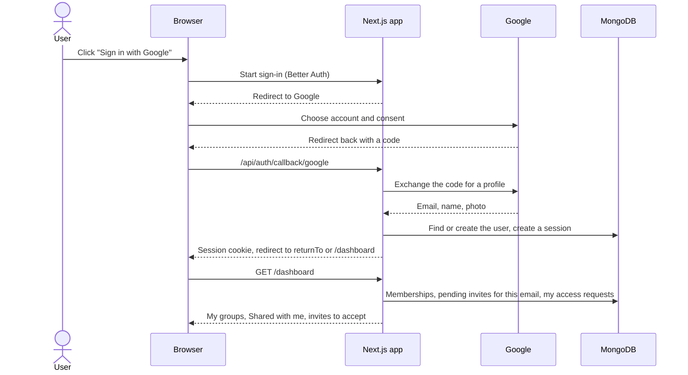

- A new user sees an empty dashboard with "Create a family group", plus any invites already waiting for their email.
- `returnTo` takes people back to the tree link they originally opened ([F4](#f4-request-access-from-a-tree-link)).

### F2. Create a group with Father's and Mother's sheets

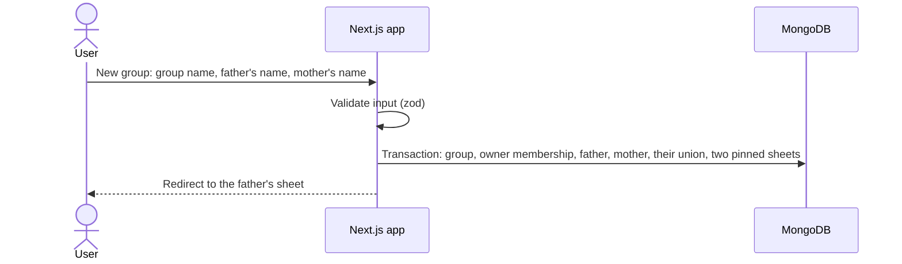

- The pinned sheets are "<Father>'s family", rooted at the father, and "<Mother>'s family", rooted at the mother.
- The user can add themselves as the couple's child in the same step.

### F3. Invite someone

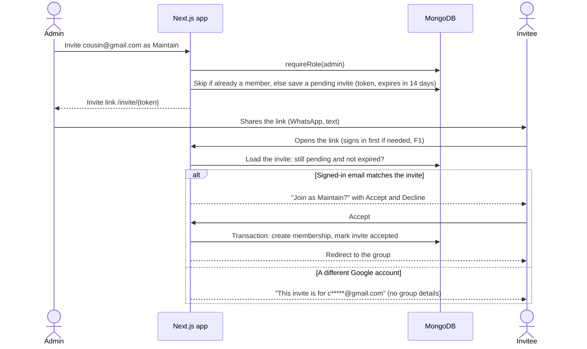

- Invites also appear on the invitee's dashboard, so the link is optional.
- Emails are compared after normalizing: lowercase, and for gmail.com dots and `+tags` are ignored.
- Admins can revoke a pending invite. Revoked and expired links do nothing.

### F4. Request access from a tree link

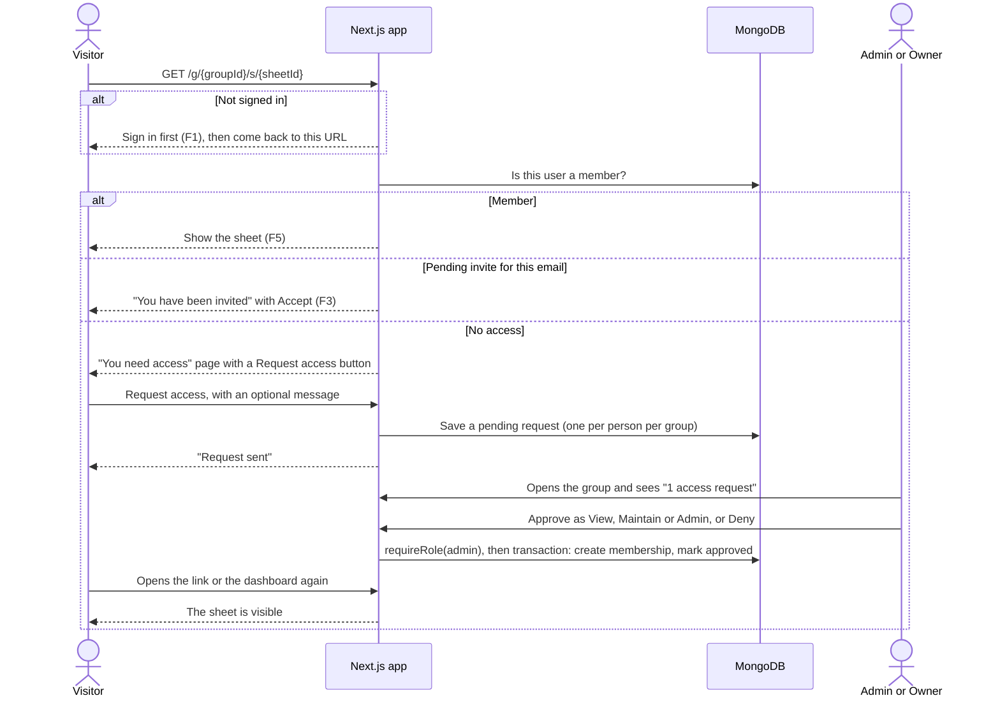

- The "You need access" page shows nothing about the group. It looks the same for a group that doesn't exist, and a request for one is silently dropped.
- The requester sees the status (pending, approved or denied) on their dashboard.

### F5. Open a sheet

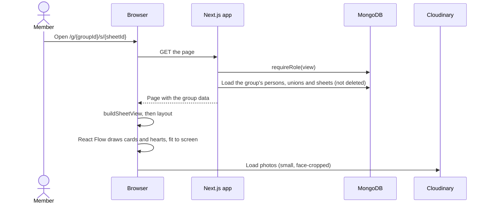

- The whole group's data is loaded once (fine up to a few thousand people), so switching sheet tabs is instant.

### F6. Edit the tree by hand

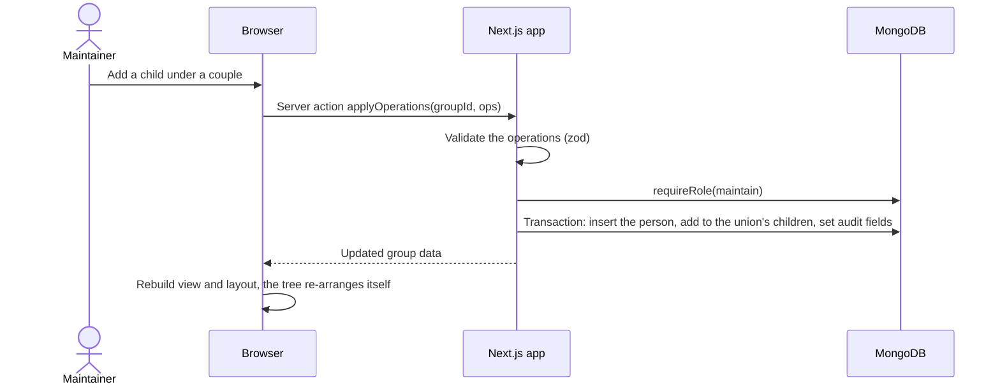

- The same `applyOperations` handles AI proposals ([F7](#f7-ai-chat-priya-married-into-our-family)) and imports ([F10](#f10-import)).
- Delete is a soft delete with Undo.

### F7. AI chat: "Priya married into our family"

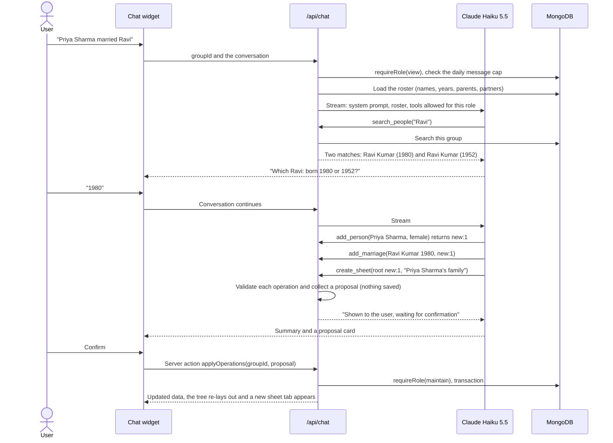

- A Viewer's chat only has the read tools. Asking it for a change gets "you have view-only access".
- The proposal card lists the changes in plain words. Confirm applies all of them or none.

### F8. Upload a photo

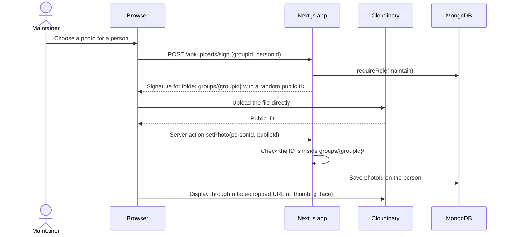

- Large photos never pass through Vercel, so its request size limit doesn't apply.
- When a photo is replaced, the old one is deleted from Cloudinary to stay within the free tier.

### F9. Export

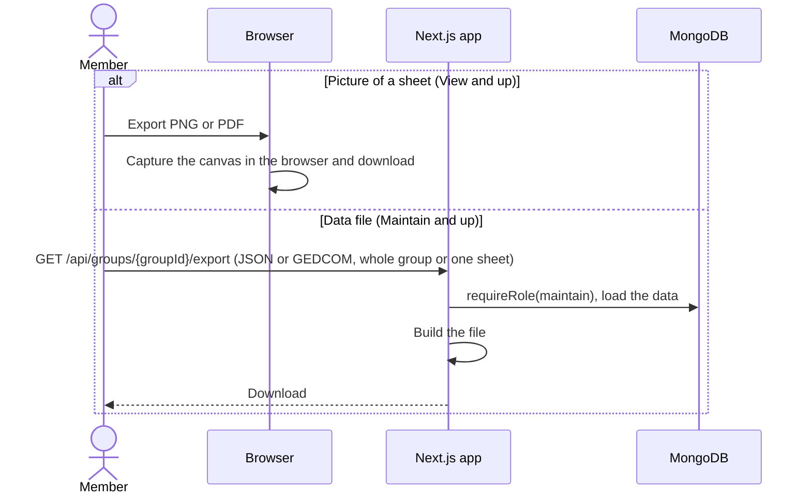

- JSON is lossless and can be re-imported. GEDCOM maps persons to `INDI` records and unions to `FAM` records.
- Exporting one sheet exports exactly the people that sheet shows ([§6](#6-sheets-views-not-copies)).

### F10. Import

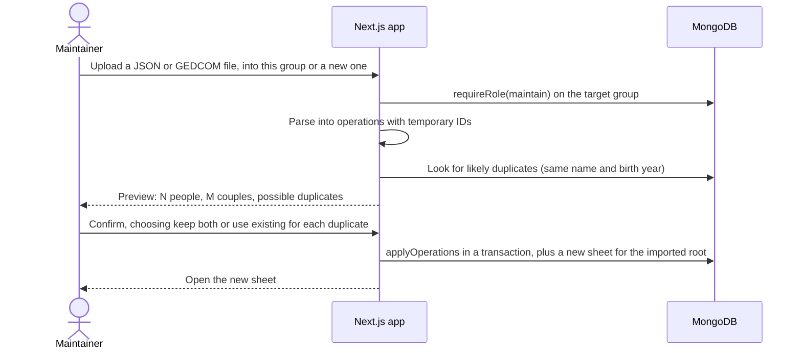

- Importing into a new group creates the group first ([F2](#f2-create-a-group-with-fathers-and-mothers-sheets)), with the importer as Owner.
- Files up to about 4 MB go through the server. Larger GEDCOM files are parsed in the browser and sent as operations.

### F11. Deploy

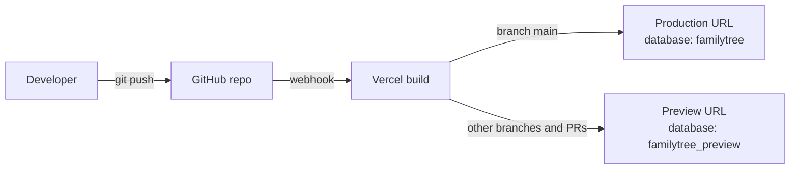

### F12. Nightly backup and restore

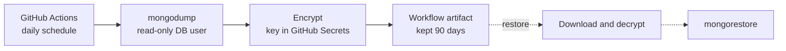

- The backup is encrypted so it stays private even if the repository is ever made public.
- Photos are not in this backup; they live in Cloudinary.

## 10. AI chat design

| Tool | What it does | Kind | Minimum role |
|---|---|---|---|
| `search_people` | Find people in this group by name and years | read | View |
| `get_person` | One person's parents, partners, children and sheets | read | View |
| `add_person` | New person; returns a temporary ID such as `new:1` | proposal | Maintain |
| `update_person` | Change name, gender or years (for example, record a death year) | proposal | Maintain |
| `add_marriage` | Join two people as a couple, married or divorced | proposal | Maintain |
| `add_child` | Add a child to a couple or a single parent | proposal | Maintain |
| `create_sheet` | New sheet rooted at a person (in-laws) | proposal | Maintain |
| `add_to_sheet` | Show a person on a sheet | proposal | Maintain |

- Proposal tools save nothing. Each one adds an operation to the pending proposal and returns a temporary ID that later calls can refer to.
- There is no delete tool. Deleting is only done in the UI.
- On Confirm, the proposal's operations go through `applyOperations`, where they are validated and permission-checked again. A tampered proposal can do nothing beyond what the user could already do by hand.

Operations shared by manual edits, AI proposals and imports:

```ts
type Ref = string; // an existing id, or a temporary id like "new:1" created earlier in the same batch

type Operation =
  | { op: "createPerson"; tempId: string; name: string; gender: "male" | "female"; birthYear?: number; deathYear?: number }
  | { op: "updatePerson"; personId: Ref; set: { name?: string; gender?: "male" | "female"; birthYear?: number | null; deathYear?: number | null } }
  | { op: "createUnion"; tempId?: string; partnerIds: [Ref] | [Ref, Ref]; status: "married" | "divorced" }
  | { op: "updateUnion"; unionId: Ref; status: "married" | "divorced" }
  | { op: "addChild"; unionId: Ref; childId: Ref }
  | { op: "createSheet"; tempId?: string; title: string; rootPersonId: Ref; pinned?: boolean }
  | { op: "addToSheet"; sheetId: Ref; personId: Ref }
  | { op: "setPhoto"; personId: Ref; photoId: string }
  | { op: "deletePerson"; personId: Ref } // UI only, never offered to the AI (soft delete)
  | { op: "restorePerson"; personId: Ref }; // UI only: Undo for deletePerson
```

How `applyOperations` works (`src/server/operations/`, built in step 3):
- The batch is validated with zod. Then, inside one transaction, the group's records are loaded and a pure planner (`planOperations`) checks every operation against them before anything is written. Errors name the failing change ("Change 3: …").
- Rules: references must exist in the same group; a couple has 1–2 different people and can't be created twice; a person has at most one set of parents and can't become their own ancestor; a death year can't be before the birth year. Repeating `addChild` or `addToSheet` changes nothing.
- All or nothing: one invalid operation rejects the batch. Concurrent edits are safe: on a write conflict MongoDB retries the transaction, which re-reads the group.

Model and prompt:
- The model comes from `CHAT_MODEL` (`claude-haiku-5-5`), and responses are streamed.
- The system prompt puts stable instructions first, so they can be cached, followed by the user's role and the group roster (id, name, years, parents, partners). For very large groups, the roster is trimmed and the model relies on `search_people`.
- Names and notes are written by users, so they are treated as data, not instructions. Even a malicious name can't cause harm, because changes need a person's click and are limited by their role.
- Cost guard: a per-user daily message cap (`CHAT_DAILY_LIMIT`, tracked in `chatUsage`), plus a monthly spend limit set in the Anthropic Console.

## 11. Security and privacy

- **Sign-in:** Google only. No passwords are stored.
- **Permissions:** checked on the server for every request ([§8](#8-permissions)).
- **Group isolation:** `groupId` is on every record and in every query.
- **Photos:** random public IDs under `groups/{groupId}/`. If stronger privacy is needed later, switch to Cloudinary's signed delivery.
- **Secrets:** only in Vercel environment variables and GitHub Secrets, never committed. `.env.local` is git-ignored.
- **Database network access:** Vercel and GitHub Actions use changing IP addresses, so Atlas must allow connections from anywhere (`0.0.0.0/0`). This is offset by a separate database user per purpose (the app gets read/write on its own database, the backup gets read-only) and long random passwords.
- **Preview deployments** use their own database, so testing can't damage real data.
- **Backups** are encrypted.
- **AI chat:** tools filtered by role, confirmation by a person before any change, and a daily cap.

## 12. Environments

| Environment | Trigger | URL | Database |
|---|---|---|---|
| Local | `npm run dev` | `http://localhost:3000` | `familytree_dev` |
| Preview | Push to any branch other than `main`, or a PR | A `*.vercel.app` URL per branch | `familytree_preview` |
| Production | Push to `main` | `<project>.vercel.app` or a custom domain | `familytree` |

- All three databases live in the one free Atlas cluster and share its 512 MB.
- Tests use throwaway `familytree_test_<time>_<label>` databases in the same cluster: one per database-test file and one per e2e run. They remove themselves afterwards, and leftovers from crashed runs are cleared after an hour.
- Google only accepts exact redirect URLs. Register the local and production URLs in the Google Cloud OAuth client. Preview URLs change, so either register a fixed branch URL or use Better Auth's OAuth proxy plugin (to be checked during setup).

## 13. Configuration

| Variable | Used by | Notes |
|---|---|---|
| `MONGODB_URI` | App; GitHub Actions (tests) | Database user with read/write only (no admin). CI uses a separate test user, stored as a repo secret |
| `MONGODB_DB` | App | `familytree`, `familytree_preview` or `familytree_dev` |
| `BETTER_AUTH_SECRET` | App | Random, at least 32 bytes |
| `BETTER_AUTH_URL` | App | Base URL of the deployment |
| `GOOGLE_CLIENT_ID`, `GOOGLE_CLIENT_SECRET` | App | Google Cloud OAuth client |
| `CLOUDINARY_CLOUD_NAME`, `CLOUDINARY_API_KEY`, `CLOUDINARY_API_SECRET` | App | |
| `ANTHROPIC_API_KEY` | App | |
| `CHAT_MODEL` | App | `claude-haiku-5-5` |
| `CHAT_DAILY_LIMIT` | App | Messages per user per day, for example 50 |
| `MONGODB_BACKUP_URI` | GitHub Actions | Read-only database user |
| `BACKUP_ENCRYPTION_KEY` | GitHub Actions | Stored in GitHub Secrets |

## 14. Limits and when to upgrade

| Resource | Free limit | When it starts to matter | Next step |
|---|---|---|---|
| MongoDB Atlas M0 | 512 MB storage | Hundreds of thousands of people (photos aren't stored here) | A paid Atlas tier |
| Vercel Hobby | Personal, non-commercial use; going over usage limits pauses the site rather than billing | Any commercial use | Vercel Pro |
| Cloudinary | Monthly credits shared by storage, bandwidth and transformations | Thousands of large photos or heavy traffic | Resize on upload, or a paid plan |
| Claude API | Paid per use | Many active chat users | Daily cap and spend limit already in place |
| Data per page | The whole group is loaded at once | Several thousand people in one group | Load each sheet's people from the server |

## 15. Open questions

1. ~~**Who approves access requests**~~ **Resolved 2026-10-18:** only Admins and the Owner, the same rule as invites.
2. ~~**Layout engine**~~ **Resolved 2026-10-18 (step 2):** ELK.js. relatives-tree couldn't draw in-law parents ([§7](#7-tree-rendering-and-auto-layout)).
3. **Better Auth organization plugin:** adopt it for groups, members and invites if it supports in-app invites without email.
4. **Google sign-in on preview deployments:** a fixed branch URL, or the OAuth proxy plugin.
