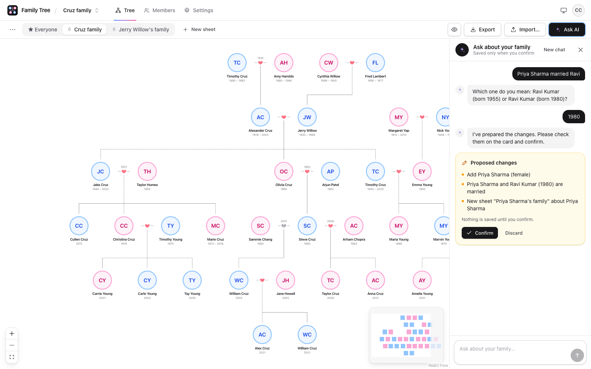
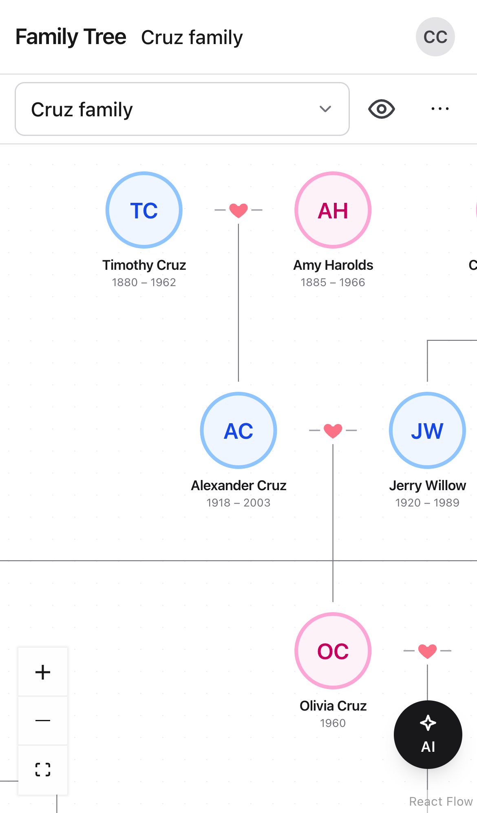
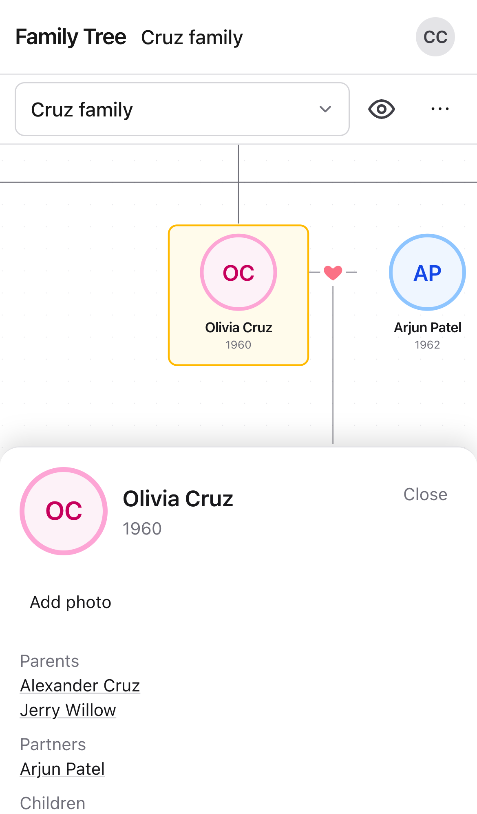
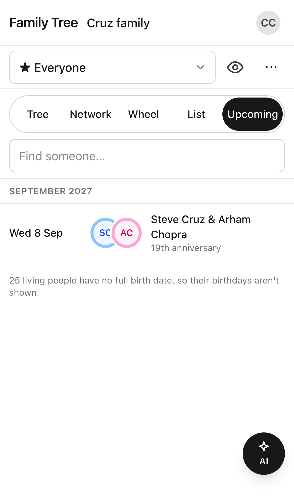
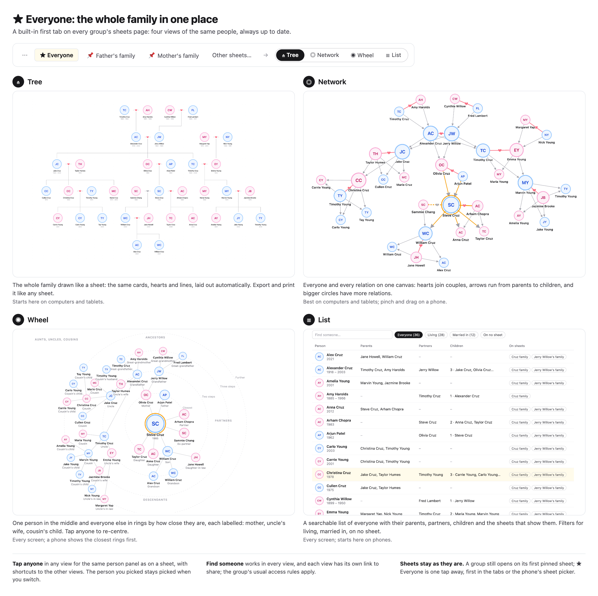
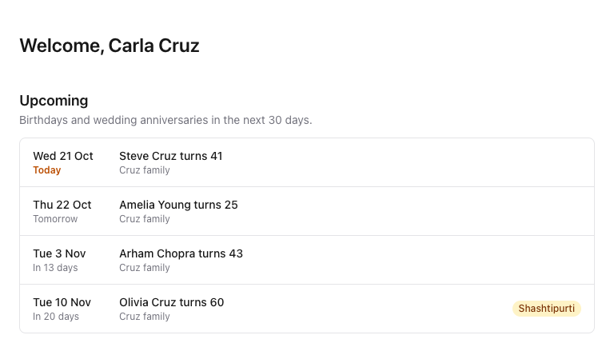
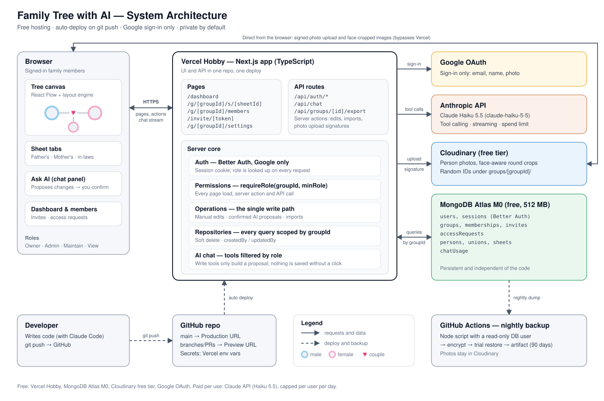

# Family Tree with AI

A web app where a family builds its tree together. People are added by hand or by chatting with an AI assistant, laid out automatically, and shared privately with relatives through their Google accounts. It runs on free tiers (Vercel, MongoDB Atlas, Cloudinary, Google sign-in); only the AI chat costs money, a few cents a month.

**Live:** https://family-tree-with-ai.vercel.app · **Docs:** [beginner's guide to the code](docs/PROJECT_GUIDE.md) · [features and decisions](docs/FEATURES.md) · [architecture](docs/ARCHITECTURE.md) · [build plan](docs/BUILD_PLAN.md)



<p>
  
  &nbsp;
  
  &nbsp;
  
</p>

## Contents

- [Features](#features), and [★ Everyone](#-everyone-the-whole-family-in-one-place)
- [Tech stack](#tech-stack)
- [Architecture](#architecture)
- [Limits and capabilities](#limits-and-capabilities)
- [Run your own copy](#run-your-own-copy): every account, setting and secret, from A to Z
- [Environment variables](#environment-variables)
- [Scripts](#scripts) and [tests](#tests)
- [Deployment workflow](#deployment-workflow)
- [Backups and restore](#backups-and-restore)
- [Security](#security)
- [Project documents](#project-documents)
- [License](#license)

## Features

**Family trees**
- **Groups.** A group holds one family's trees and is what you share. Create one with the father's and mother's names (and yourself as their child); it starts with two pinned sheets, "<Father>'s family" and "<Mother>'s family". The dashboard lists My groups and Shared with me.
- **Sheets are views, not copies.** Each person is stored once. A sheet shows a root person's ancestors, their descendants and partners, so a child added once appears on every sheet that reaches them. Someone who marries in gets their own sheet for their parents and cousins; a mother gets a sheet for her side of the family, and her parents and cousins show there rather than on her children's sheets.
- **Automatic layout** in the style of a classic family tree: round photos with a light blue (male) or light pink (female) ring, a heart between partners (broken when divorced), children hanging below. Living people show only their birth year ("1985"), others "1945 – 2022"; a selected card shows full dates where known ("12 Mar 1945 – 3 Jun 2022"). The year a couple married shows above their heart, and the full date while one of them is selected.
- **Editing by hand.** Click a person to edit them, add parents, a partner or a child, show them on another sheet, go to their own sheet, or delete them (with Undo). Click a heart to mark a couple married or divorced. Create, rename, pin, reorder and delete sheets.

**Photos**
- Add, change or remove a person's photo from their panel (JPEG, PNG, WebP or iPhone HEIC, up to 10 MB). It goes straight from the browser to Cloudinary; cards show a round, face-cropped thumbnail.
- **The eye button** hides every photo and shows initials instead, for sharing a picture of the tree without faces.

**AI assistant**
- "Ask AI" opens a chat beside the tree (Claude Haiku). Ask about the family ("Who are Jake's grandchildren?") or tell it about someone new ("Priya married Ravi in 2010").
- It asks when a name is ambiguous, then proposes the changes on a card. **Nothing is saved until you press Confirm**, and the server checks the change like any other edit. Viewers can ask questions only. 50 messages per person per day (configurable).

**Sharing and roles**
- Everything is private until you invite someone. Admins invite relatives by email and share the link (WhatsApp, text); it only works for that Google account.
- Someone who opens a tree link without access can request it; Admins approve (choosing the role) or deny. The page shows nothing about the group to non-members.
- Roles: **View** (see, ask the AI, save a picture), **Maintain** (edit people, photos and sheets, import, export data), **Admin** (manage members), **Owner** (one per group: rename, delete, hand over the group). Checked on the server for every request.

**Import and export**
- GEDCOM 5.5.1 (Ancestry, FamilySearch, MyHeritage and others) and the app's own lossless JSON, for one sheet or the whole group.
- Import into a group or a new one, with a preview that finds possible duplicates first.
- Save a sheet as a picture (PNG) or print it (and so save a PDF). Everyone can do this, Viewers included.

**Everywhere**
- **Phones, tablets and computers.** On small screens: a sheet picker, one ⋯ menu for the tools, details over the bottom half of the screen, a round Ask AI button, and touch-sized controls.
- **Day and night themes**, or follow the device.
- **Nightly encrypted backups**, each one trial-restored before it's kept for 90 days.
- **Hardened:** security headers and a Content Security Policy on every page, and a smoke test of the live site after every deployment.

The owner's full requirements and every agreed decision are in [docs/FEATURES.md](docs/FEATURES.md).

### ★ Everyone: the whole family in one place



A built-in first tab on every group's sheets page that shows every person and how they're related, in five views:

| View | What it shows | Best on |
|---|---|---|
| ⋔ **Tree** | The whole family drawn like a sheet, laid out automatically; export and print it like any sheet | Computers and tablets, where it's the first view |
| ◎ **Network** | Everyone and every relation on one canvas: hearts join couples, arrows run from parents to children, bigger circles have more relations | Computers and tablets |
| ◉ **Wheel** | One person in the middle and everyone else in rings by how close they are, each labelled (mother, uncle's wife, cousin's child) | Every screen |
| ☰ **List** | A searchable list with each person's parents, partners, children and the sheets that show them | Every screen; a phone's first view |
| ▦ **Upcoming** | Everyone's next birthday ("Turns 41") and every couple's next wedding anniversary over the next 12 months, nearest first, with Shashtipurti, Silver and Golden marked | Every screen |

- ★ Everyone comes first in the tab row (first in the sheet picker on phones), but a group still opens on its first pinned sheet, or its first sheet when none is pinned.
- Tapping anyone, in any view, opens the same person panel as on a sheet (editing for Maintain and up), with shortcuts to the other views. The person you picked stays picked when you switch, and each view has its own link to share.
- **All five views are built.** Find someone selects a person and moves to them (in the List it narrows the rows; in the Wheel it puts them in the middle). The List filters Everyone, Living, Married in and On no sheet. In the Network, choosing someone lights up their parents, partners and children. The Wheel labels everyone with their relation in Telugu relationship names written in English letters (Amma, Babai, Menamama, Bava…) or, with the "తె | En" toggle, in English. Upcoming lists the next 12 months of birthdays and anniversaries by month, for people with full dates. A person's panel has "Find in list", "Show in network" and "Relatives wheel", on any sheet too. The picture above shows them with the sample family. The agreed details are in [docs/FEATURES.md](docs/FEATURES.md#everyone-agreed-2026-10-20-all-four-views-built-tree-list-network-wheel).

The dashboard lists the birthdays and anniversaries in the next 30 days across your groups, with milestones marked, and a person's panel shows their age:



## Tech stack

| Layer | Choice | Why |
|---|---|---|
| Framework | [Next.js](https://nextjs.org) 16 (App Router, server components and actions, Turbopack), React 19, TypeScript | UI and API in one app and one deploy |
| UI | Tailwind CSS 4 | Responsive styling, day and night themes |
| Tree canvas | [React Flow](https://reactflow.dev) (`@xyflow/react` 12) | Pan, zoom, minimap, custom cards |
| Auto-layout | [ELK.js](https://eclipse.dev/elk/) (layered); [d3-force](https://d3js.org/d3-force) for the Network | Draws in-law parents and keeps lines from crossing; arranges thousands of people in seconds |
| Sign-in | [Better Auth](https://www.better-auth.com) 1.7, Google only | Sessions in our own database; an OAuth proxy for preview deployments |
| Database | [MongoDB Atlas](https://www.mongodb.com/atlas) M0 (free, 512 MB), official `mongodb` driver | Persistent, independent of the code, transactions |
| Validation | zod 4 | One set of rules for forms, server actions, AI tools and imports |
| Photos | [Cloudinary](https://cloudinary.com) (free plan) | Direct browser uploads, face-aware crops |
| AI chat | [Claude API](https://docs.anthropic.com) (`@anthropic-ai/sdk`), `claude-haiku-5-5` | Tool calling and streaming, cheap |
| Pictures | html-to-image | The whole sheet as a PNG, in the browser |
| Hosting | [Vercel](https://vercel.com) Hobby | Deploys every push; a preview URL per branch |
| CI and backups | GitHub Actions | Tests on every push, the nightly backup, the smoke test |
| Tests | Vitest 5 (unit, database), Playwright 1.64 (end-to-end on desktop, phone and tablet) | |

## Architecture



How it fits together:

- **One Next.js app is both UI and API**, deployed to Vercel. Server-only code lives in `src/server/`; pure tree logic (which people a sheet shows, edits, layout) lives in `src/tree/` and runs in the browser and in unit tests.
- **The browser loads a group's whole tree once** and computes each sheet itself, so switching sheets is instant. Layout runs in the browser too.
- **One write path.** Manual edits, confirmed AI proposals and imports all become a list of operations, applied by `applyOperations` in one MongoDB transaction with the same validation.
- **Permissions on every request.** Every page, server action and route checks the caller's role, read fresh from the database; every query carries the group's id. "No access" looks the same whether a group exists or not.
- **Photos skip the app server:** the app signs an upload for a random name in the group's folder, and the browser sends the file straight to Cloudinary.
- **The AI never writes.** Its tools only look things up or build a proposal; a person confirms, and the proposal goes through the same server action as a manual edit.
- **Three databases in one free cluster:** `familytree_dev` (your machine), `familytree_preview` (Vercel previews) and `familytree` (production), plus throwaway databases for tests.
- **Previews sign in through production** with Better Auth's OAuth proxy, so Google needs only two redirect URIs.

Key decisions, each with its reasons:

| Decision | Instead of | Why |
|---|---|---|
| Vercel Hobby | Render's free tier | Render sleeps after 15 idle minutes (a 30–60 s wait) and has 0.1 CPU |
| Each person stored once; sheets are views | Copying people into each sheet | Nothing to keep in sync: a child added once shows on every sheet |
| ELK.js | relatives-tree | relatives-tree only draws the root's own relatives, so it dropped in-law parents |
| Our own groups and memberships | Better Auth's organization plugin | One transaction for a new group and its family, exactly one owner, gmail-aware invite matching |
| The AI proposes, a person confirms | Letting the AI write | Ambiguous names ("which Ravi?") and wrong guesses never reach the data |
| Files read in the browser for import | An upload route | No upload size limit, and the server only ever sees ordinary edits |
| A Node script for backups | `mongodump` | Runs anywhere Node does, encrypts, and proves each backup by restoring it |
| One fixed Content Security Policy | Per-request nonces | Pages keep their prebuilt shell; nonces would make every page render per request |

The full design (code layout, data model, sheet rules, permissions table, flows F1–F12, the AI design, security) is in [docs/ARCHITECTURE.md](docs/ARCHITECTURE.md).

## Limits and capabilities

**Free-tier limits**

| Service | Limit | When it matters |
|---|---|---|
| MongoDB Atlas M0 | 512 MB, shared and throttled | Hundreds of thousands of people (photos aren't stored there) |
| Vercel Hobby | Personal, non-commercial use; going over the usage limits pauses the site instead of billing | Any commercial use |
| Cloudinary free | Monthly credits shared by storage, bandwidth and transformations | Tens of thousands of photos or heavy traffic (photos are stored at most 1600 px, cards load 168 px crops) |
| Claude API | Paid per use (Haiku: roughly under $1 a month at ~200 messages) | Many chat users; capped per person per day and by your Anthropic spend limit |
| GitHub Actions | Free for public repositories; 2,000 minutes a month for private ones | A private copy pushing often (a CI run takes about ten minutes) |

**Built into the app**

| What | Limit |
|---|---|
| Names, sheet titles, group names | 120 characters |
| One import | 2,000 people (20,000 changes, 4 MB) |
| Photos | JPEG, PNG, WebP or HEIC, up to 10 MB |
| AI chat | 50 messages per person per day (`CHAT_DAILY_LIMIT`); the model gets the first 300 people as its family list and looks others up |
| Invites | Last 14 days |
| Access requests | 20 waiting per person |
| Sessions | 30 days, extended while in use |
| Backups | Kept 90 days |
| A group | Loaded whole into the browser: comfortable up to a few thousand people |

**Not built (yet)**
- Hiding one extra person from a sheet; copying photos when importing into a different group.
- Email notifications for invites and requests (they show in the app, plus a link to share).
- A cap on groups per account: anyone with a Google account can sign up and create groups (an accepted risk; see [Security](#security)).
- Automatic tests in Safari's engine: phone and tablet tests run in Chrome's device emulation.

## Run your own copy

Everything you need to fork this repository and run it on your own accounts. Allow about an hour. Each service is free except the Claude API, which is optional, as is Cloudinary.

### 1. Before you start

**Accounts**

| Service | Needed for | Cost |
|---|---|---|
| [GitHub](https://github.com) | The code, CI, backups | Free |
| [Vercel](https://vercel.com) | Hosting | Free (Hobby) |
| [MongoDB Atlas](https://www.mongodb.com/cloud/atlas/register) | The database | Free (M0) |
| [Google Cloud](https://console.cloud.google.com) | Google sign-in | Free |
| [Cloudinary](https://cloudinary.com/users/register_free) | Photos (optional) | Free plan |
| [Anthropic Console](https://console.anthropic.com) | The AI chat (optional) | Prepaid credits |

**On your computer:** Node.js 24 or newer, npm, git, `openssl` (for the secrets), and Google Chrome (the end-to-end tests use it locally).

**Pick your app's name now.** Vercel will serve production at `https://<project-name>.vercel.app`, where the project name is the one you choose when importing the repository. Below it's written as `https://YOUR-APP.vercel.app`; you need it for Google's settings before the first deploy. If the name is taken, Vercel adds a suffix; step 9 covers fixing it afterwards.

### 2. Fork and install

Fork the repository on GitHub, then:

```bash
git clone https://github.com/<you>/<your-fork>.git
cd <your-fork>
npm install
cp .env.example .env.local     # filled in during the next steps; git ignores it
```

### 3. MongoDB Atlas

1. Sign up at [MongoDB Atlas](https://cloud.mongodb.com), create a project, and **create a free M0 cluster**. Choose **AWS, us-east-1 (N. Virginia)** if you can: Vercel runs the app in Washington, D.C. (`iad1`) by default, and every page reads the database, so the two should be close. If you pick another region, see step 9.6.
2. **Network Access → Add IP Address → Allow access from anywhere** (`0.0.0.0/0`). Vercel and GitHub Actions connect from changing addresses. This is offset by a separate user per purpose, each with a long random password.
3. **Database Access → Add New Database User**, with password authentication (use "Autogenerate Secure Password" and keep each password in your password manager). Create these users:

   | User (any name) | Privileges | Used by |
   |---|---|---|
   | `familytree-local` | Built-in role **Read and write to any database** | `.env.local`: your dev server, `npm run db:setup` for every database, and the tests, which create throwaway `familytree_test_*` databases |
   | `familytree-ci` | Built-in role **Read and write to any database** | GitHub secret `MONGODB_URI` (CI runs the database and end-to-end tests) |
   | `familytree-prod` | Specific privilege **readWrite** on database `familytree` | Vercel, Production |
   | `familytree-preview` | Specific privilege **readWrite** on database `familytree_preview` | Vercel, Preview |
   | `familytree-backup` | Specific privilege **read** on database `familytree` | GitHub secret `MONGODB_BACKUP_URI` (the nightly backup) |

   The two test users can write to every database in the cluster, production included. For complete separation, put the tests on a second free cluster in another Atlas project (each project gets one M0) and use its users for `familytree-local` and `familytree-ci`.

4. **Connect → Drivers** shows the connection string, of the form `mongodb+srv://<user>:<password>@<cluster>.xxxxx.mongodb.net/?retryWrites=true&w=majority&appName=<cluster>`. Make one per user by putting in its name and password (URL-encode any special characters). Leave the database name out of it: the app reads `MONGODB_DB`.
5. You don't create the databases: MongoDB creates each on first use. Keep the names `familytree_dev`, `familytree_preview` and `familytree` (the nightly backup reads `familytree`).
6. In `.env.local`, set `MONGODB_URI` to the `familytree-local` string and `MONGODB_DB=familytree_dev`, then:

   ```bash
   npm run db:ping     # "Connected to familytree_dev. Collections: (none yet)"
   npm run db:setup    # creates the indexes; safe to repeat
   ```

### 4. Google sign-in

1. In the [Google Cloud console](https://console.cloud.google.com), create a project (for example "Family Tree").
2. Open **Google Auth Platform** (also reached from APIs & Services → OAuth consent screen) and **Get started**: the app name and your support email, **Audience: External**, your contact email, then create it.
3. **Data Access:** nothing to add. The app asks only for the basic `openid`, `email` and `profile` scopes, which Google doesn't review.
4. **Clients → Create client → Web application**, and under **Authorized redirect URIs** add exactly:
   - `http://localhost:3000/api/auth/callback/google`
   - `https://YOUR-APP.vercel.app/api/auth/callback/google`

   No JavaScript origins are needed. Create it, then copy the **Client ID** and **Client secret** (keep the secret in your password manager; Google may not show it again).
5. **Audience → Publish app.** While it's in Testing, only the test users you list can sign in.

You don't add preview URLs: previews sign in through production (Better Auth's OAuth proxy). Using a custom domain later? Add its callback URL here and set `BETTER_AUTH_URL` to it.

Put the two values in `.env.local` as `GOOGLE_CLIENT_ID` and `GOOGLE_CLIENT_SECRET`.

### 5. Cloudinary (photos, optional)

1. Sign up for the [free plan](https://cloudinary.com/users/register_free).
2. **Console → Settings (gear) → API Keys:** copy the **Cloud name**, an **API Key** and its **API Secret** (you can generate a key just for this app).
3. That's all. There's no upload preset or folder to create: the app signs each upload itself, for a random name under `groups/<groupId>/`, and tags it with the database's name, so one account serves your computer, previews and production.

Put them in `.env.local` as `CLOUDINARY_CLOUD_NAME`, `CLOUDINARY_API_KEY` and `CLOUDINARY_API_SECRET`. Without them the app works, showing initials and no photo buttons.

### 6. Claude API (the AI chat, optional)

1. Sign up at the [Anthropic Console](https://console.anthropic.com) and buy some credits under **Billing** (a few dollars lasts a long time with Haiku).
2. Under **Limits**, set a **monthly spend limit**.
3. **API Keys → Create Key**, and put it in `.env.local` as `CHAT_API_KEY`. Keep `CHAT_MODEL=claude-haiku-5-5` and `CHAT_DAILY_LIMIT=50` (messages per person per day), or change them.

It's not called `ANTHROPIC_API_KEY` on purpose: tools such as Claude Code read that name from the environment, and would pick up the app's key. Without `CHAT_API_KEY` the app works, with no "Ask AI".

### 7. Generate the secrets

Each secret is 32 random bytes; run this once per value:

```bash
openssl rand -base64 32
```

| Secret | How many | Goes in |
|---|---|---|
| `BETTER_AUTH_SECRET` | Three different values: one each for your computer, Production and Preview | `.env.local`, Vercel |
| `OAUTH_PROXY_SECRET` | One value, the **same** in Production and Preview | Vercel |
| `BACKUP_ENCRYPTION_KEY` | One value | A GitHub secret, **and your password manager**: without it no backup can be read |

Changing `BETTER_AUTH_SECRET` later signs everyone out of that environment.

### 8. Run it locally

Your `.env.local` now looks like this:

```bash
MONGODB_URI=mongodb+srv://familytree-local:<password>@<cluster>.xxxxx.mongodb.net/?retryWrites=true&w=majority
MONGODB_DB=familytree_dev
BETTER_AUTH_SECRET=<your local secret>
BETTER_AUTH_URL=http://localhost:3000
GOOGLE_CLIENT_ID=<...>.apps.googleusercontent.com
GOOGLE_CLIENT_SECRET=<...>
CLOUDINARY_CLOUD_NAME=<...>      # optional
CLOUDINARY_API_KEY=<...>
CLOUDINARY_API_SECRET=<...>
CHAT_API_KEY=<...>               # optional
CHAT_MODEL=claude-haiku-5-5
CHAT_DAILY_LIMIT=50
```

Then:

```bash
npm run seed    # optional: a 36-person sample family, drawn at http://localhost:3000/dev/tree/db
npm run dev     # http://localhost:3000
```

Open **`http://localhost:3000`** (not `127.0.0.1`: Google and the session cookie treat them as different sites), sign in with Google, and create a group. The `/dev/*` pages (the layout playground at `/dev/tree`) exist only under `npm run dev`.

Keep local settings in `.env.local`: Next.js also reads a `.env` file, but only for variables `.env.local` doesn't set.

### 9. Deploy on Vercel

1. At [vercel.com](https://vercel.com), sign in with GitHub, then **Add New… → Project** and import your fork. Set the **project name** to the `YOUR-APP` you chose. Leave the framework (`vercel.json` pins it to Next.js) and the build settings as they are.
2. Before the first deploy, open **Environment Variables** and add these, choosing the environments for each (mark the secrets **Sensitive**; leave Development empty):

   | Variable | Production | Preview |
   |---|---|---|
   | `MONGODB_URI` | the `familytree-prod` string | the `familytree-preview` string |
   | `MONGODB_DB` | `familytree` | `familytree_preview` |
   | `BETTER_AUTH_SECRET` | the Production secret | the Preview secret (a different one) |
   | `BETTER_AUTH_URL` | `https://YOUR-APP.vercel.app` | **not set**: previews use their own address |
   | `OAUTH_PROXY_SECRET` | the proxy secret | the **same** proxy secret |
   | `GOOGLE_CLIENT_ID`, `GOOGLE_CLIENT_SECRET` | from step 4 | the same |
   | `CLOUDINARY_CLOUD_NAME`, `CLOUDINARY_API_KEY`, `CLOUDINARY_API_SECRET` | from step 5 (optional) | the same |
   | `CHAT_API_KEY`, `CHAT_MODEL`, `CHAT_DAILY_LIMIT` | from step 6 (optional) | the same |

3. Under **Settings → Environment Variables**, keep **Automatically expose System Environment Variables** turned on. Previews take their address from `VERCEL_URL` and `VERCEL_BRANCH_URL`, and the OAuth proxy finds production through `VERCEL_PROJECT_PRODUCTION_URL`.
4. **Deploy.** If production's address isn't what you planned (Vercel added a suffix, or you add a custom domain), set `BETTER_AUTH_URL` to it, add its callback URL in Google (step 4), and **redeploy**: variable changes only reach new deployments.
5. Create the indexes in both Vercel databases, from your computer (it uses `.env.local`'s `familytree-local` user):

   ```bash
   MONGODB_DB=familytree_preview npm run db:setup
   MONGODB_DB=familytree npm run db:setup
   ```

6. **Region.** The app's functions run in `iad1` (Washington, D.C.) unless told otherwise. If your Atlas cluster is elsewhere, add the nearest [Vercel region](https://vercel.com/docs/edge-network/regions) to `vercel.json`, for example `"regions": ["fra1"]` for Frankfurt, and push.

Sign in at `https://YOUR-APP.vercel.app`. From then on, every push to `main` updates production, and every other branch gets its own preview URL with the `familytree_preview` database. A preview can sign in with Google once production has been deployed with `OAUTH_PROXY_SECRET`. Vercel protects previews with Vercel Authentication by default, so only you (signed in to Vercel) can open them.

### 10. GitHub: Actions, secrets and alerts

1. **Turn on Actions.** GitHub disables workflows on forks: open the **Actions** tab and enable them. Scheduled workflows need their own switch: **Actions → Nightly backup → Enable workflow**.
2. **Settings → Secrets and variables → Actions → New repository secret**, three times:

   | Secret | Value | Used by |
   |---|---|---|
   | `MONGODB_URI` | the `familytree-ci` string | [ci.yml](.github/workflows/ci.yml): lint, type-check, unit, database and end-to-end tests on every push |
   | `MONGODB_BACKUP_URI` | the `familytree-backup` string | [backup.yml](.github/workflows/backup.yml): the nightly backup |
   | `BACKUP_ENCRYPTION_KEY` | the backup key from step 7 | backup.yml, and `npm run restore` |

3. **The smoke test's address.** [smoke.yml](.github/workflows/smoke.yml) checks the live site after every successful production deployment (Vercel reports deployments to GitHub). Tell it your site: **Settings → Secrets and variables → Actions → Variables → New repository variable**, named `SMOKE_URL`, with the value `https://YOUR-APP.vercel.app`. It's a variable, not a secret, so the run's log shows which site was checked; without it, the workflow checks the original app's site.
4. **Settings → Code security → Dependabot alerts: Enable**, for emails about known vulnerabilities.
5. Run each workflow once by hand (**Actions → the workflow → Run workflow**) to check the secrets: CI, Nightly backup (it also trial-restores the backup) and Production smoke test.

### 11. Make it yours

| What | Where |
|---|---|
| The smoke test's address (required) | The `SMOKE_URL` repository variable (step 10.3) |
| The live link and screenshots | This README |
| The functions' region, if your cluster isn't near Washington | `vercel.json` (step 9.6) |
| The backup's time (UTC) | `cron` in `.github/workflows/backup.yml` (now 21:17 UTC) |
| The chat model and daily limit | `CHAT_MODEL`, `CHAT_DAILY_LIMIT` in Vercel |
| Database names, if you must change them | `MONGODB_DB` everywhere, plus `BACKUP_DB` in backup.yml's backup step |

The documents in `docs/` record how the original was built and mention its address; they don't need changing.

### 12. Check that everything works

- [ ] Sign in at `https://YOUR-APP.vercel.app` and create a group with the father's and mother's names.
- [ ] Add a person by hand; add a photo (with Cloudinary); ask the AI to add someone and confirm the card (with the Claude API).
- [ ] Invite a second Google account as View, and open the link from that account.
- [ ] Push a branch, open its preview, and sign in with Google there.
- [ ] Actions: CI is green, Nightly backup is green (and has a `backup-<date>` artifact), and the Production smoke test is green.
- [ ] Export the group as GEDCOM and import it into a new group.

## Environment variables

[.env.example](.env.example) lists them with notes; [docs/ARCHITECTURE.md §13](docs/ARCHITECTURE.md#13-configuration) describes each one, test-only ones included.

| Variable | Local | Vercel Production | Vercel Preview | GitHub secret | Notes |
|---|:-:|:-:|:-:|:-:|---|
| `MONGODB_URI` | ✓ | ✓ | ✓ | ✓ | A different database user in each place (step 3) |
| `MONGODB_DB` | `familytree_dev` | `familytree` | `familytree_preview` | | |
| `BETTER_AUTH_SECRET` | ✓ | ✓ | ✓ | | Different everywhere |
| `BETTER_AUTH_URL` | `http://localhost:3000` | your URL | | | Previews use Vercel's system variables |
| `OAUTH_PROXY_SECRET` | | ✓ | ✓ | | The same in both |
| `GOOGLE_CLIENT_ID`, `GOOGLE_CLIENT_SECRET` | ✓ | ✓ | ✓ | | |
| `CLOUDINARY_CLOUD_NAME`, `CLOUDINARY_API_KEY`, `CLOUDINARY_API_SECRET` | optional | optional | optional | | Without them: initials, no photo buttons |
| `CHAT_API_KEY` | optional | optional | optional | | Without it: no Ask AI |
| `CHAT_MODEL`, `CHAT_DAILY_LIMIT` | optional | optional | optional | | Default `claude-haiku-5-5` and 50 |
| `MONGODB_BACKUP_URI`, `BACKUP_ENCRYPTION_KEY` | only for `npm run backup` | | | ✓ | `npm run restore` asks for the key |
| `VERCEL_*` system variables | | auto | auto | | "Automatically expose System Environment Variables" |
| `SMOKE_URL` | for `npm run test:smoke` | | | a repository **variable** | The site the smoke test checks; the original app's site unless set |

Secrets live only in `.env.local` (git-ignored), Vercel and GitHub Secrets.

## Scripts

| Command | What it does |
|---|---|
| `npm run dev` | Development server on port 3000 |
| `npm run build` / `npm start` | Production build and server |
| `npm run lint` | ESLint |
| `npm run typecheck` | Generates Next.js route types, then runs the TypeScript compiler |
| `npm test` | Unit tests (Vitest); no database needed |
| `npm run test:watch` | Vitest in watch mode |
| `npm run test:db` | Database integration tests against Atlas (`*.db.test.ts`), each file in its own throwaway database |
| `npm run test:e2e` | End-to-end tests (Playwright) on desktop, phone and tablet: builds the app and serves it on port 3100 with a throwaway seeded database |
| `npm run test:smoke` | Checks the live site as a signed-out visitor (`SMOKE_URL` for another site) |
| `npm run test:ai-live` | One real conversation with the chat model, run by hand (well under a cent; needs `CHAT_API_KEY`) |
| `npm run db:ping` | Checks the connection in `.env.local` |
| `npm run db:setup` | Creates the indexes in `MONGODB_DB` (safe to repeat) |
| `npm run seed` | Loads the sample family into `MONGODB_DB`; view it at `/dev/tree/db` |
| `npm run backup` | Writes an encrypted backup of `familytree` to `backups/`; normally the nightly workflow does it |
| `npm run restore -- <file> …` | Restores a backup ([below](#backups-and-restore)) |

## Tests

- **Unit** (`npm test`, about 300 tests): sheet rules, layout, the write path's rules, permissions, the AI's tools, GEDCOM and JSON, viewport maths, components. No network.
- **Database** (`npm run test:db`): transactions, persistence, group isolation and role checks against Atlas. Each file gets its own `familytree_test_*` database, emptied afterwards (leftovers from crashed runs are cleared after an hour).
- **End-to-end** (`npm run test:e2e`, about 60 tests): a production build on port 3100, three projects (desktop Chrome, iPhone 13 and iPad emulation). Each run seeds its own database. Test users sign in through a Playwright fixture that writes sessions into that database; the app has no test-login route. Cloudinary and the Claude API are replaced by local stand-ins on ports 3101 and 3102, so no test reaches Google, Cloudinary or Anthropic. Locally it uses your installed Google Chrome (or run `npx playwright install chromium` and set `CI=1`).
- **Smoke** (`npm run test:smoke`): the live site, signed out only, after every production deployment.

The database and end-to-end tests need `MONGODB_URI` with permission to create databases (the `familytree-local` user). From a laptop far from the cluster each save takes a few seconds, so the tests allow up to 15 seconds per check.

## Deployment workflow

- Work on a branch. Every push runs CI (lint, type-check, unit, database and end-to-end tests) and gets a Vercel preview with the `familytree_preview` database.
- Merge to `main` to deploy production; the smoke test then checks the live site.
- When a change adds indexes, run `npm run db:setup` against `familytree_preview` and `familytree` (step 9.5) before merging.
- [vercel.json](vercel.json) pins the framework to Next.js. With the wrong Framework Preset, Vercel treats the app as a static site and fails with "No Output Directory named "public" found".

## Backups and restore

Every night at 21:17 UTC (02:47 in India), [backup.yml](.github/workflows/backup.yml) backs up the production database `familytree`. It uses the read-only `MONGODB_BACKUP_URI` user, encrypts the file (AES-256-GCM) with `BACKUP_ENCRYPTION_KEY`, restores it into a throwaway MongoDB inside the runner to prove it works, and keeps it 90 days as the run's artifact. Photos aren't included; they stay in Cloudinary. Run it any time from **Actions → Nightly backup → Run workflow**; if a run fails, GitHub emails you.

**Keep the key in your password manager.** Without it no backup can be read.

To restore, download the run's `backup-<date>` artifact, unzip it, then in your terminal (with `MONGODB_URI` in `.env.local`):

```bash
npm run restore -- familytree-<time>.ftbackup --check              # a trial: restores into a throwaway database, compares counts, empties it
npm run restore -- familytree-<time>.ftbackup familytree_restored  # into a new database
npm run restore -- familytree-<time>.ftbackup familytree --replace # over production, replacing what's there
```

It asks for the key (typing isn't shown), refuses a database that already has records unless given `--replace`, and checks every collection's count against the file. Sessions aren't backed up, so after a restore everyone signs in again.

## Security

- **Google sign-in only,** with Google-verified emails; no passwords stored. Sessions are httpOnly cookies; Google's tokens are stored encrypted.
- **Every request is checked on the server:** the role is read from the database each time, every query carries the group's id, and a unit test fails if a new server action or route doesn't check its caller. Inputs from the browser are validated (zod) before any query.
- **Headers on every page:** a Content Security Policy, HSTS, `X-Frame-Options: DENY`, a strict referrer policy and more. Every end-to-end test fails on a policy violation.
- **Photos** have random, unguessable names in the group's folder, and only Maintain and up get an upload signature.
- **Separate database users** per purpose, a separate preview database, and encrypted, read-only backups.
- **Accepted risks:** anyone with a Google account can sign up and create groups (they could fill the free cluster, and each gets 50 chat messages a day; your Anthropic spend limit caps the cost); server actions have no rate limit of their own. Details in [docs/ARCHITECTURE.md §11](docs/ARCHITECTURE.md#11-security-and-privacy).

## Project documents

| Document | What's in it |
|---|---|
| [docs/PROJECT_GUIDE.md](docs/PROJECT_GUIDE.md) | Start here if you're new: the project's folders and files explained with diagrams, four journeys through the code, where to start reading, and a glossary |
| [docs/FEATURES.md](docs/FEATURES.md) | The owner's requirements, then every agreed decision, under the same headings |
| [docs/ARCHITECTURE.md](docs/ARCHITECTURE.md) | The design: code layout, data model, sheet rules, layout, permissions, flows F1–F12, the AI chat, security, environments, configuration, limits |
| [docs/BUILD_PLAN.md](docs/BUILD_PLAN.md) | How it was built, step by step, with the notes and bugs found at each step |
| [AGENTS.md](AGENTS.md), [.claude/CLAUDE.md](.claude/CLAUDE.md) | Working rules for AI coding assistants |

`.npmrc` keeps `package-lock.json` free of registry download URLs, so each machine installs from its own registry (the public npm registry on Vercel and CI). After an install, `grep -c '"resolved"' package-lock.json` should print `0`.

## License

[MIT](LICENSE): use, copy, change and share it, keeping the copyright notice.
