# A beginner's guide to the code

This guide is for someone opening this project for the first time. It explains, mostly with pictures, what the app is made of, what each folder and file is for, and what happens inside the code when someone clicks something.

You don't need to read it all at once. Sections 1 and 2 give you the big picture; the rest is a map you can come back to. Words you may not know are explained in the [glossary](#15-glossary) at the end.

**Contents**

1. [The app in one picture](#1-the-app-in-one-picture)
2. [Six ideas that explain most of the code](#2-six-ideas-that-explain-most-of-the-code)
3. [The top-level folders](#3-the-top-level-folders)
4. [Inside `src/`: four layers](#4-inside-src-four-layers)
5. [`src/app`: every page and address](#5-srcapp-every-page-and-address)
6. [`src/components`: the pieces you see](#6-srccomponents-the-pieces-you-see)
7. [`src/tree`: the family logic](#7-srctree-the-family-logic)
8. [`src/server`: code that only runs on the server](#8-srcserver-code-that-only-runs-on-the-server)
9. [What's saved in the database](#9-whats-saved-in-the-database)
10. [Follow a click: four journeys through the code](#10-follow-a-click-four-journeys-through-the-code)
11. [Tests: how the project checks itself](#11-tests-how-the-project-checks-itself)
12. [Scripts, automation and deployment](#12-scripts-automation-and-deployment)
13. [Settings files at the root](#13-settings-files-at-the-root)
14. [Where to start reading](#14-where-to-start-reading)
15. [Glossary](#15-glossary)

---

## 1. The app in one picture

**Family Tree with AI** is a website where a family builds its tree together. People are added by hand or by chatting with an AI assistant, the tree arranges itself on screen, and it is shared privately with relatives who sign in with their Google accounts.

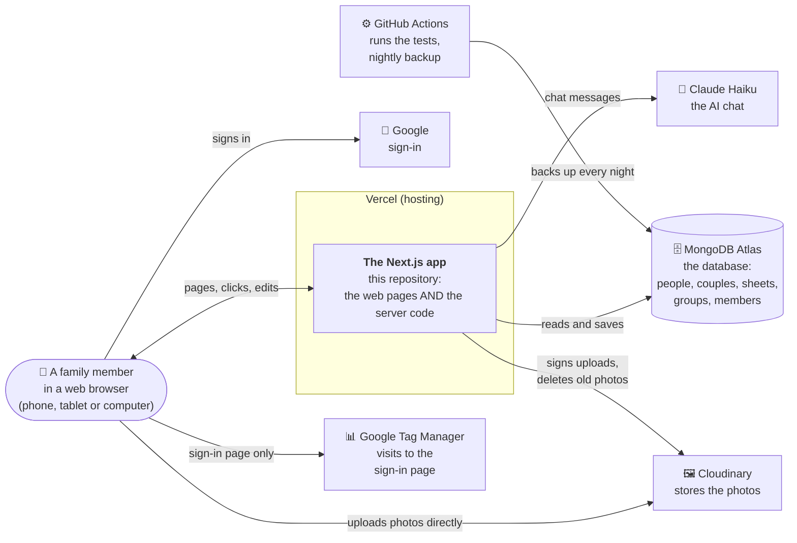

| Piece | What it is | Why the app needs it |
|---|---|---|
| **The Next.js app** | The code in this repository | Draws the pages *and* answers requests: there is no separate "backend" project |
| **Vercel** | A hosting service | Runs the app on the internet and rebuilds it on every push |
| **MongoDB Atlas** | A database in the cloud | Keeps the families, users and permissions |
| **Google** | Sign-in provider | Nobody needs a new password; "Sign in with Google" is the only way in |
| **Cloudinary** | A photo service | Stores photos and crops them around faces |
| **Claude Haiku** | Anthropic's AI model | Answers questions about the family and suggests changes |
| **GitHub Actions** | Automation on GitHub | Runs every test on every push, backs up the database every night |
| **Google Tag Manager** | Google's tag service, with Google Analytics | Counts visits to the sign-in page, and only that page (on the live site, when `GTM_ID` is set) |

All of these have free tiers except the AI chat, which costs a few cents a month.

---

## 2. Six ideas that explain most of the code

Once you know these six ideas, most files make sense.

### Idea 1: one project, two halves

The same repository holds code that runs **in the browser** (what you see and click) and code that runs **on the server** (which talks to the database and keeps secrets). Next.js decides which is which.

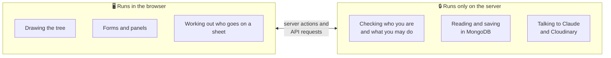

The browser can never be trusted (anyone can change what their browser sends), so **every permission check happens on the server.**

### Idea 2: each person is stored once; a sheet is a *view*

A family is too big for one screen, so it's split into **sheets** (tabs like "Dad's family" and "Mum's family"). But a sheet doesn't *copy* people. It only stores *who it starts from* (its root person), and the code works out who to show every time it's drawn.

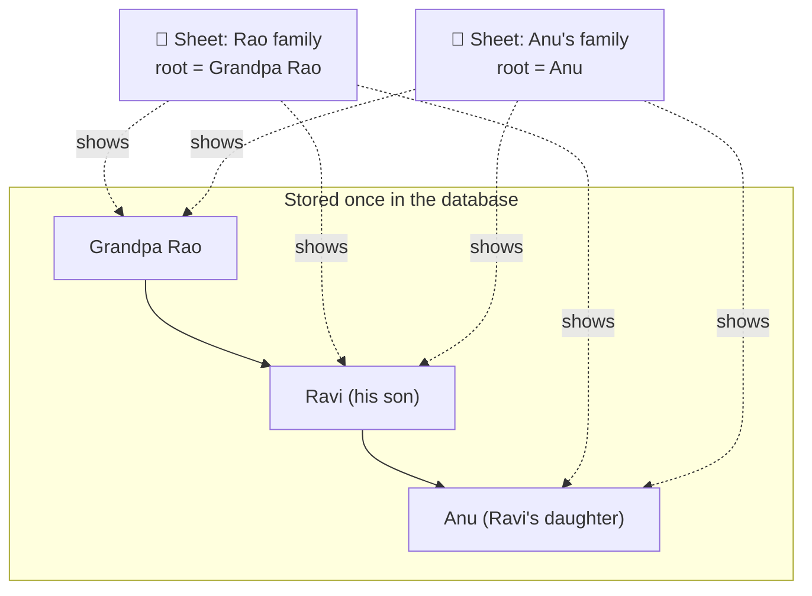

Fix Anu's birth year once and both sheets show the change, because there is only one Anu. The function that decides who belongs on a sheet is `buildSheetView()` in [src/tree/sheet-view.ts](../src/tree/sheet-view.ts). There is also a built-in **★ Everyone** tab that shows the whole family at once, with five views (Tree, Network, Wheel, List, Upcoming).

### Idea 3: a couple is its own record (the ♥)

Parents and children aren't linked person-to-person. Instead, a **union** (a couple, drawn as a heart) holds one or two partners and their children. One partner alone means a single parent.

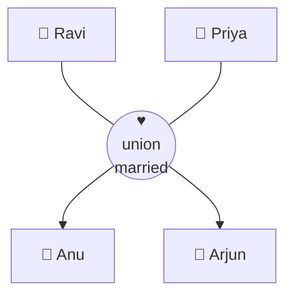

A person can be a child of **at most one** union. This is the same shape genealogy files use (GEDCOM's "FAM" records), which makes import and export simple.

### Idea 4: every change goes through one door

Whether a change comes from a form, from the AI or from an imported file, it's first turned into a list of small instructions called **operations** (`createPerson`, `addChild`, `setPhoto`…). That list goes through **one** function, `applyOperations`, which checks it and saves it all at once, or not at all.

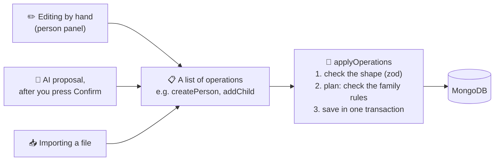

Because there is only one door, the rules ("a person can't be their own parent", "a photo must be in this group's folder"…) live in one place: the planner in [src/server/operations/plan.ts](../src/server/operations/plan.ts).

### Idea 5: the server checks your role every single time

Each family is a **group**. Each member of a group has a **role**:

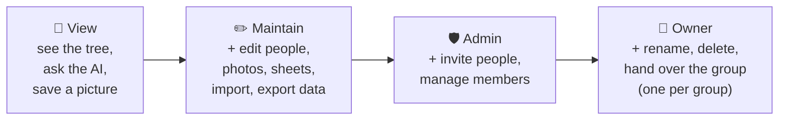

Every page, server action and API route reads your role **from the database** on each request (it is never trusted from the browser or kept in the session). And "you have no access" looks exactly the same whether a group exists or not, so outsiders can't even learn that a group exists.

### Idea 6: the AI suggests, a person confirms

The AI assistant can look things up, but it **cannot save anything**. When you say "Priya married Ravi in 2010", it prepares operations and shows them on a card. Only when you press **Confirm** are they sent through the same door as a hand edit (Idea 4), with the same checks.

---

## 3. The top-level folders

```
Family Tree with AI/
│
├── src/                  ← the app itself (everything users touch)
│   ├── app/              ← pages and addresses (URLs)
│   ├── components/       ← reusable pieces of screen (buttons, panels, the tree canvas)
│   ├── tree/             ← pure family logic: who's on a sheet, layout, relations, dates
│   ├── server/           ← server-only code: database, sign-in, permissions, AI, backups
│   └── proxy.ts          ← the doorman: sends signed-out visitors to the sign-in page
│
├── test/                 ← shared test data (a sample family) and test helpers
├── e2e/                  ← "end-to-end" tests: a robot browser clicks through the real app
├── smoke/                ← a quick test of the live website after each deployment
├── scripts/              ← command-line tools: set up the database, add sample data, back up, restore, make the site's pictures
├── docs/                 ← the project's documents (plans, architecture, this guide, screenshots, GitHub's social preview)
├── .github/workflows/    ← automation that runs on GitHub (tests, nightly backup, smoke test)
├── .github/FUNDING.yml   ← the repository's ❤ Sponsor button (GitHub Sponsors, Buy Me a Coffee)
├── .claude/              ← instructions for the Claude Code AI assistant (CLAUDE.md)
│
├── package.json          ← the list of libraries and the "npm run …" commands
├── next.config.ts        ← Next.js settings
├── README.md             ← the front page: features, how to run your own copy
└── … other settings files (see section 13)
```

The four `docs/` documents that drive the work:

| Document | In one line |
|---|---|
| [FEATURES.md](FEATURES.md) | What the owner asked for, and every decision that was agreed |
| [ARCHITECTURE.md](ARCHITECTURE.md) | The blueprint: how the code is organised, the data, the rules, the flows |
| [BUILD_PLAN.md](BUILD_PLAN.md) | The step-by-step build plan, with notes on every step and its Progress table |
| [IDEAS.md](IDEAS.md) | Possible future features, none agreed yet |

---

## 4. Inside `src/`: four layers

Think of `src/` as four layers, each with one job. The arrows show who uses whom.

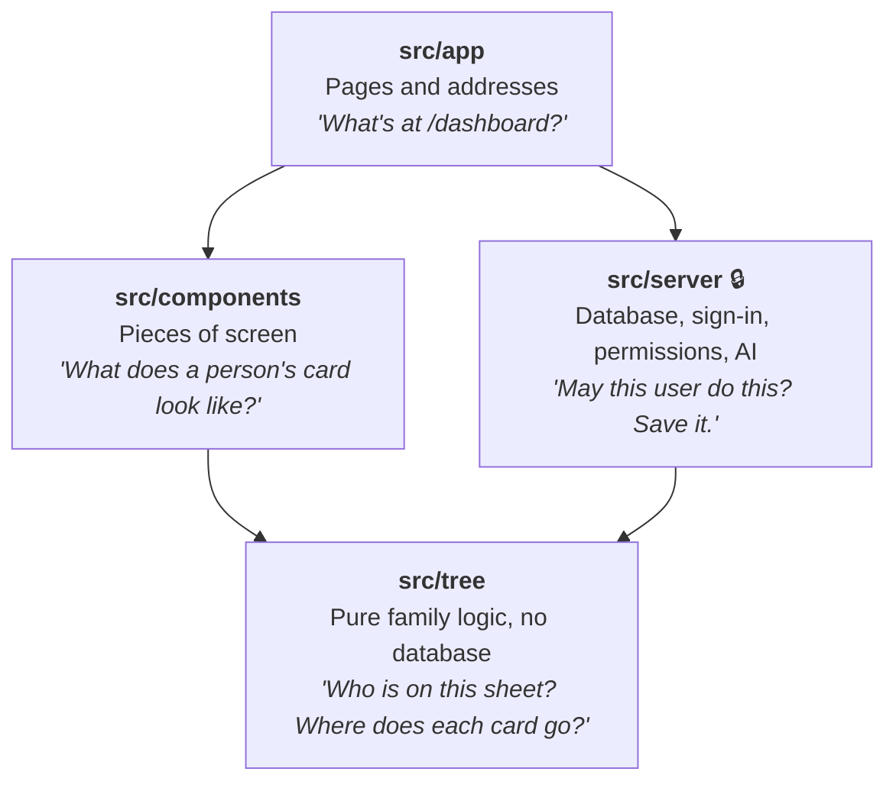

A quick way to decide where something belongs:

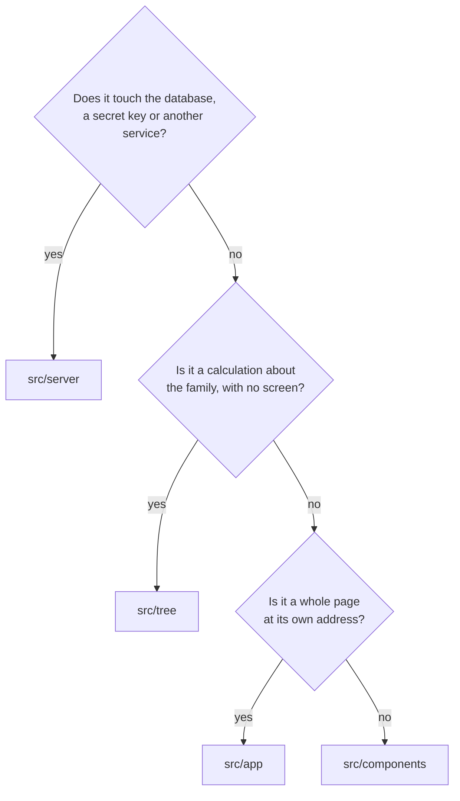

Imports use shortcuts: `@/` means `src/` and `@test/` means `test/` (set in [tsconfig.json](../tsconfig.json)). So `import { buildSheetView } from "@/tree/sheet-view"` reads `src/tree/sheet-view.ts`.

> **One exception to the layers:** the browser borrows a few things from `src/server` that are safe to share: the *types* of operations, and the import/export converters in `src/server/import-export/`, which are pure so that files can be read in the browser before anything is sent.

---

## 5. `src/app`: every page and address

### How Next.js turns folders into addresses

In Next.js's "App Router", **the folder path is the web address**. A few special file names have fixed meanings:

| File name | Meaning |
|---|---|
| `page.tsx` | The page shown at this folder's address |
| `layout.tsx` | A frame drawn around every page in this folder and below it |
| `route.ts` | An API endpoint (answers with data, not a page) |
| `actions.ts` | **Server actions**: functions the browser can call that run on the server (marked `"use server"`) |
| `[groupId]` | A folder in square brackets is a *variable* part of the address |

So `src/app/g/[groupId]/members/page.tsx` is the page at `/g/65f1…/members`, where `65f1…` is the group's id.

### The map of addresses

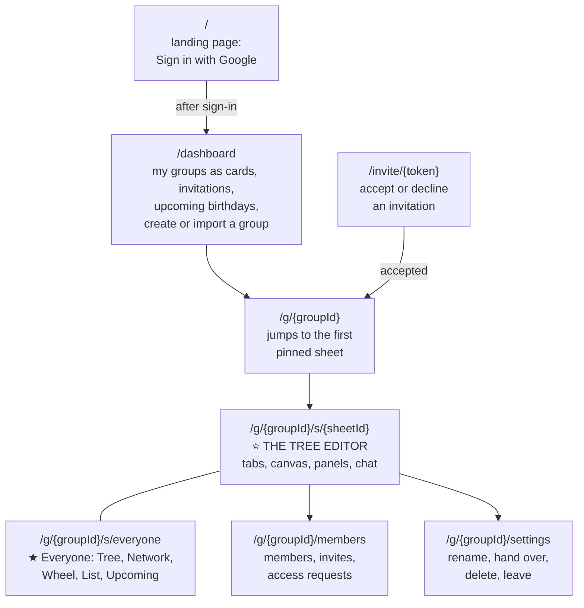

| Address | Files | Who can see it |
|---|---|---|
| `/` | [app/page.tsx](../src/app/page.tsx), its parts in [components/landing/](../src/components/landing/) | Everyone, and search engines (the only page they see) |
| `/dashboard` | [dashboard/page.tsx](../src/app/dashboard/page.tsx), plus `NewGroupForm.tsx`, `ImportNewGroup.tsx`, `UpcomingSoon.tsx`, `actions.ts` | Anyone signed in |
| `/g/{groupId}` | [g/[groupId]/page.tsx](../src/app/g/[groupId]/page.tsx) | Members (View and up) |
| `/g/{groupId}/s/{sheetId}` | [s/layout.tsx](../src/app/g/[groupId]/s/layout.tsx) loads the data, [s/GroupSheets.tsx](../src/app/g/[groupId]/s/GroupSheets.tsx) runs the editor. The `[sheetId]/page.tsx` is empty on purpose: the layout stays on screen while you switch tabs | View to look, Maintain to edit |
| `/g/{groupId}/members` | [members/page.tsx](../src/app/g/[groupId]/members/page.tsx), `MembersForms.tsx`, `columns.ts`, `actions.ts` | Admin and Owner (other members see a short note) |
| `/g/{groupId}/settings` | [settings/page.tsx](../src/app/g/[groupId]/settings/page.tsx), `SettingsForms.tsx`, `SettingsNav.tsx`, `actions.ts` | Members (the Owner sees rename, hand over and delete; others see Leave) |
| `/invite/{token}` | [invite/[token]/page.tsx](../src/app/invite/[token]/page.tsx), `InviteAnswer.tsx`, `actions.ts` | The person invited |
| `/dev/tree` | [dev/](../src/app/dev/) | Developers only (404 on the real site) |

The API endpoints (they answer with data, not pages):

| Endpoint | File | What it does |
|---|---|---|
| `/api/auth/…` | [api/auth/[...all]/route.ts](../src/app/api/auth/[...all]/route.ts) | Google sign-in and sessions, handled by the Better Auth library |
| `/api/chat` | [api/chat/route.ts](../src/app/api/chat/route.ts) | One turn of the AI chat, streamed back bit by bit |
| `/api/groups/{groupId}/export` | [api/groups/[groupId]/export/route.ts](../src/app/api/groups/[groupId]/export/route.ts) | Downloads a group or sheet as JSON or GEDCOM (Maintain and up) |

Two more files in `src/app`: [layout.tsx](../src/app/layout.tsx) is the frame around *every* page (it sets the page title and applies the day/night theme before anything is drawn), and [globals.css](../src/app/globals.css) holds the site-wide styles.

And the files that browsers, search engines and chat apps ask for by name:

| File | Address | What it is |
|---|---|---|
| [robots.ts](../src/app/robots.ts) | `/robots.txt` | Tells search engines what they may read: on the live site only the landing page; elsewhere nothing |
| [sitemap.ts](../src/app/sitemap.ts) | `/sitemap.xml` | The list of public pages for search engines: just the landing page |
| [icon.svg](../src/app/icon.svg), `favicon.ico`, `apple-icon.png` | `/icon.svg` … | The app's icon (a couple, a heart and two children) for browser tabs, search results and phones' home screens |
| `opengraph-image.png` | `/opengraph-image.png` | The picture chat apps and social sites show when someone shares a link |
| [not-found.tsx](../src/app/not-found.tsx), [error.tsx](../src/app/error.tsx) | any address that doesn't exist; any page that fails | The app's own "This page isn't here" and "Something went wrong" pages, with a way back |

### The tree editor, piece by piece

The sheets page is the heart of the app. Here's how its screen is built:

```
+------------------------------------------------------------------------+
| AppHeader  Family Tree / group v   Tree  Members  Settings  Theme  HK  |
+------------------------------------------------------------------------+
| SheetTabs  ... [* Everyone | Dad's family | Mum's family]  + New sheet |
|                                 (eye)  Export  Import...  [Ask AI]     |
+--------------------------------------------+---------------------------+
|                                            |  One side panel at a time |
|  FamilyCanvas (drawn with React Flow)      |                           |
|                                            |  PersonPanel              |
|     +------------+          +------------+ |    (a card was clicked)   |
|     | PersonNode |---(<3)---| PersonNode | |  CouplePanel              |
|     +------------+    |     +------------+ |    (a heart was clicked)  |
|                       |                    |  ImportPanel              |
|              +--------+--------+           |  ChatWidget (Ask AI)      |
|              |                 |           |                           |
|        +------------+   +------------+     |                           |
|        | PersonNode |   | PersonNode |     |                           |
|        +------------+   +------------+     |                           |
|                                            |                           |
|     (<3) = UnionNode, the heart            |                           |
+--------------------------------------------+---------------------------+
          all of this is held together by GroupSheets.tsx
```

`GroupSheets.tsx` keeps the whole group's family in memory (loaded once), works out the current sheet's view, and has a `run(ops)` function that every panel uses to save a change. On phones and tablets the same pieces rearrange themselves: a drop-down picks the sheet, tools move into a ⋯ menu, and panels slide up over the bottom of the screen.

---

## 6. `src/components`: the pieces you see

Components are reusable building blocks of the screen, written in React (`.tsx` files). Small helper files (`.ts`) sit beside them.

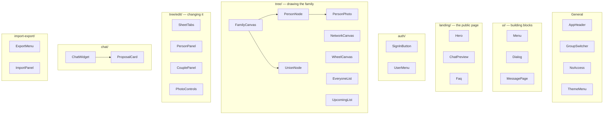

**General**

| File | What it does |
|---|---|
| [AppHeader.tsx](../src/components/AppHeader.tsx), [GroupHeader.tsx](../src/components/GroupHeader.tsx) | The bar at the top of signed-in pages: the app's icon, and on a group's pages its switcher and its pages as tabs (Tree, Members, Settings). `GroupHeader` loads what a group's header needs |
| [GroupSwitcher.tsx](../src/components/GroupSwitcher.tsx), [ThemeMenu.tsx](../src/components/ThemeMenu.tsx) | The group's name, opening your other groups; the theme as one button (Day, Night, Follow device) |
| [NoAccess.tsx](../src/components/NoAccess.tsx), [RequestAccessForm.tsx](../src/components/RequestAccessForm.tsx) | The "no access" page (identical in every case) and its Request access form |
| [ThemeToggle.tsx](../src/components/ThemeToggle.tsx), [theme.ts](../src/components/theme.ts), [theme-script.ts](../src/components/theme-script.ts) | Day / Night / Follow device. The script runs before the page is painted, so it never flashes white |
| [screen.ts](../src/components/screen.ts) | `isPhone()` and `isTabletOrPhone()`, for the few things CSS can't do |
| [today.ts](../src/components/today.ts) | `useToday()`: today's date from your device (for birthdays) |
| [support.ts](../src/components/support.ts) | The owner's Buy Me a Coffee address, linked from the landing page and the user menu |
| [GoogleTagManager.tsx](../src/components/GoogleTagManager.tsx) | Google Tag Manager's two snippets, drawn on the landing page only (when `GTM_ID` is set) |
| [initials.ts](../src/components/initials.ts), [short-date.ts](../src/components/short-date.ts), [use-hydrated.ts](../src/components/use-hydrated.ts), [request-messages.ts](../src/components/request-messages.ts) | Small helpers: "Jake Cruz" → "JC", short dates, "is the page ready for clicks yet?", shared messages |

**`ui/`: building blocks every page uses**

| File | What it does |
|---|---|
| [button.ts](../src/components/ui/button.ts) | The look of every button and button-like link: primary, secondary, ghost, danger |
| [Menu.tsx](../src/components/ui/Menu.tsx) | Drop-down menus that work with the mouse, a finger and the keyboard |
| [Dialog.tsx](../src/components/ui/Dialog.tsx) | Dialogs over the page (create a group, import a file): Escape, a click outside or Close end them |
| [field.ts](../src/components/ui/field.ts) | The look of text fields, their labels, checkboxes, radios and form errors |
| [card.ts](../src/components/ui/card.ts), [badge.ts](../src/components/ui/badge.ts), [page.ts](../src/components/ui/page.ts) | The look of cards (white panels on the grey page), badges (roles, counts) and a page's frame |
| [Avatar.tsx](../src/components/ui/Avatar.tsx) | An account's initials in a circle (the account menu, members, requests) |
| [PageHeader.tsx](../src/components/ui/PageHeader.tsx) | A page's heading, the sentence under it and its main buttons |
| [Skeleton.tsx](../src/components/ui/Skeleton.tsx) | Grey blocks in the page's shape while it loads |
| [GradientSparkle.tsx](../src/components/ui/GradientSparkle.tsx) | Ask AI's sparkle, in the blue-to-pink gradient |
| [Toast.tsx](../src/components/ui/Toast.tsx) | The short "Saved." and "deleted, Undo" messages over the tree |
| [MessagePage.tsx](../src/components/ui/MessagePage.tsx) | A card in the middle of the page, for pages that say one thing (no access, an invite, not found) |
| [icons.tsx](../src/components/ui/icons.tsx) | The app's line icons |

**`landing/`: the landing page**

| File | What it does |
|---|---|
| [content.ts](../src/components/landing/content.ts) | The words search engines read twice: the title, the description, the questions and answers, and the structured data built from them |
| [LandingHeader.tsx](../src/components/landing/LandingHeader.tsx), [LandingFooter.tsx](../src/components/landing/LandingFooter.tsx) | The top bar (logo, links to the page's parts, the theme switch) and the footer |
| [Hero.tsx](../src/components/landing/Hero.tsx) | The top: what the app is, Sign in with Google, and the app on a computer and a phone |
| [Showcase.tsx](../src/components/landing/Showcase.tsx), [ChatPreview.tsx](../src/components/landing/ChatPreview.tsx) | The AI assistant (its conversation drawn as text), the relatives wheel, the network, birthdays, and three phones |
| [Features.tsx](../src/components/landing/Features.tsx), [Faq.tsx](../src/components/landing/Faq.tsx) | The three steps, six features and privacy; the questions and answers and the last sign-in button |
| [section.tsx](../src/components/landing/section.tsx), [frames.tsx](../src/components/landing/frames.tsx), [icons.tsx](../src/components/landing/icons.tsx) | Shared pieces: a section and its heading, the computer and phone frames around screenshots, line icons |
| `images/` | The screenshots, as small WebP files made by `npm run images` |

**`auth/`: signing in**

| File | What it does |
|---|---|
| [SignInButton.tsx](../src/components/auth/SignInButton.tsx) | The "Sign in with Google" button (styled by Google's rules) |
| [UserMenu.tsx](../src/components/auth/UserMenu.tsx) | Your initials in the corner, with Sign out |
| [auth-client.ts](../src/components/auth/auth-client.ts) | Better Auth's browser-side helper |
| [return-to.ts](../src/components/auth/return-to.ts) | After sign-in, brings you back to the link you opened (safely) |

**`tree/`: drawing the family**

| File | What it does |
|---|---|
| [FamilyCanvas.tsx](../src/components/tree/FamilyCanvas.tsx) | Draws a sheet: cards, hearts and lines, with zoom and pan (React Flow) |
| [PersonNode.tsx](../src/components/tree/PersonNode.tsx) | One person's card: photo, name, years |
| [UnionNode.tsx](../src/components/tree/UnionNode.tsx) | The heart between partners (broken when divorced), with the wedding year |
| [PersonPhoto.tsx](../src/components/tree/PersonPhoto.tsx), [photo.ts](../src/components/tree/photo.ts) | The round photo or initials; `photoUrl()` builds the Cloudinary address |
| [HidePhotosButton.tsx](../src/components/tree/HidePhotosButton.tsx) | The 👁 button: initials instead of faces |
| [FindSomeone.tsx](../src/components/tree/FindSomeone.tsx) | The search box on ★ Everyone |
| [ViewSwitcher.tsx](../src/components/tree/ViewSwitcher.tsx) | ★ Everyone's Tree · Network · Wheel · List · Upcoming buttons |
| [NetworkCanvas.tsx](../src/components/tree/NetworkCanvas.tsx) | Everyone as circles joined by relations |
| [WheelCanvas.tsx](../src/components/tree/WheelCanvas.tsx), [name-style.ts](../src/components/tree/name-style.ts) | One person in the middle, relatives in rings, named in Telugu or English |
| [EveryoneList.tsx](../src/components/tree/EveryoneList.tsx) | A searchable, sortable table of everyone |
| [UpcomingList.tsx](../src/components/tree/UpcomingList.tsx) | Birthdays and anniversaries in the next 12 months |
| [framing.ts](../src/components/tree/framing.ts) | Where the "camera" points: fit the sheet, or zoom to readable size on phones |
| [canvas-actions.ts](../src/components/tree/canvas-actions.ts) | What clicking a card or heart does |
| [sheet-picture.ts](../src/components/tree/sheet-picture.ts) | Saves the sheet as a PNG picture or prints it |

**`tree/edit/`: changing the family**

| File | What it does |
|---|---|
| [SheetTabs.tsx](../src/components/tree/edit/SheetTabs.tsx) | The row of sheet tabs (a drop-down on phones) and the sheet's ⋯ menu |
| [PersonPanel.tsx](../src/components/tree/edit/PersonPanel.tsx) | Opens when you click a card: details, Edit, Add parents / partner / child, Delete… |
| [CouplePanel.tsx](../src/components/tree/edit/CouplePanel.tsx) | Opens when you click a heart: married or divorced, wedding date, Add child |
| [person-form.tsx](../src/components/tree/edit/person-form.tsx) | The name, gender and dates form, reused by every "add" and "edit" |
| [PhotoControls.tsx](../src/components/tree/edit/PhotoControls.tsx), [upload-photo.ts](../src/components/tree/edit/upload-photo.ts) | Add, change or remove a photo; sends the file straight to Cloudinary |
| [panel.ts](../src/components/tree/edit/panel.ts) | Where panels go: beside the tree on big screens, over it on phones |

**`chat/` and `import-export/`**

| File | What it does |
|---|---|
| [ChatWidget.tsx](../src/components/chat/ChatWidget.tsx) | The Ask AI conversation (kept in the browser) |
| [ProposalCard.tsx](../src/components/chat/ProposalCard.tsx) | The AI's suggested changes, with Confirm and Discard |
| [chat-stream.ts](../src/components/chat/chat-stream.ts) | Reads the reply as it streams in, piece by piece |
| [ExportMenu.tsx](../src/components/import-export/ExportMenu.tsx) | Export: picture, print, JSON, GEDCOM |
| [ImportPanel.tsx](../src/components/import-export/ImportPanel.tsx) | Reads a file, previews it, flags possible duplicates, then saves |

---

## 7. `src/tree`: the family logic

Everything here is **pure**: given the same input it always gives the same output, and it never touches the database, the network or the screen. That's why it can run both in the browser and in fast tests.

### From data to a drawn tree

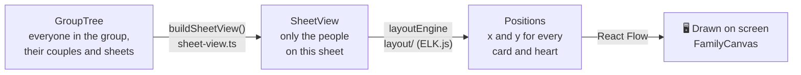

### What each file does

| File | What it does |
|---|---|
| [types.ts](../src/tree/types.ts) | The shapes everything shares: `Person`, `Union`, `Sheet`, `GroupTree`, `SheetView`. **Read this first.** |
| [sheet-view.ts](../src/tree/sheet-view.ts) | `buildSheetView()`: who belongs on a sheet (ancestors, then their descendants, then partners, then extras) |
| [layout/](../src/tree/layout/) | Where each card goes. `index.ts` picks the engine, `elk.ts` uses ELK.js, `shared.ts` places the hearts |
| [generations.ts](../src/tree/generations.ts) | Which row (generation) each person sits on |
| [edits.ts](../src/tree/edits.ts) | Turns form actions into operations: `addChildOps`, `addParentsOps`, `editPersonOps`… |
| [years.ts](../src/tree/years.ts) | Birth, death and wedding dates: checking them and showing them ("12 Mar 1985") |
| [describe.ts](../src/tree/describe.ts) | Writes operations in plain words, for the AI's proposal card |
| [everyone.ts](../src/tree/everyone.ts) | ★ Everyone: the whole family as one view, the List's rows and filters |
| [network.ts](../src/tree/network.ts) | ★ Everyone's Network: arranges circles with physics-like forces (d3-force) |
| [kinship.ts](../src/tree/kinship.ts) | How two people are related, with Telugu and English names (mother, uncle's wife…) |
| [wheel.ts](../src/tree/wheel.ts) | ★ Everyone's Wheel: rings and angles around the middle person |
| [upcoming.ts](../src/tree/upcoming.ts) | Next birthdays and anniversaries, ages, milestones |

Most files have a `*.test.ts` twin beside them with their unit tests.

---

## 8. `src/server`: code that only runs on the server

This is where secrets, the database and permission checks live. The most sensitive files (`auth.ts`, `permissions.ts`, `group-changed.ts`) start with `import "server-only"`, which makes the build fail if browser code ever tries to import them.

### The path a request takes

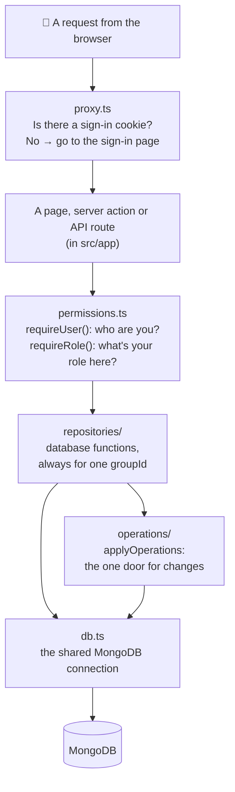

### Files at the top of `src/server`

| File | What it does |
|---|---|
| [db.ts](../src/server/db.ts) | Opens the MongoDB connection once and reuses it |
| [auth.ts](../src/server/auth.ts), [auth-options.ts](../src/server/auth-options.ts), [auth-urls.ts](../src/server/auth-urls.ts) | Sets up Better Auth (Google sign-in): its settings and the site addresses it trusts |
| [permissions.ts](../src/server/permissions.ts) | `getUser()`, `requireUser()`, `requireRole()`: who you are and what you may do |
| [roles.ts](../src/server/roles.ts) | The table of roles and actions (`can(role, action)`) |
| [proxy-rules.ts](../src/server/proxy-rules.ts) | The rules behind `src/proxy.ts`: which pages are public |
| [members-rules.ts](../src/server/members-rules.ts) | Who may change whose role; email tidying (Gmail dots, `+tags`) |
| [group-changed.ts](../src/server/group-changed.ts) | After a change, tells Next.js to refresh the group's pages |
| [ids.ts](../src/server/ids.ts) | `toObjectId()`: turns a text id into a MongoDB id, safely |
| [cloudinary.ts](../src/server/cloudinary.ts), [photos.ts](../src/server/photos.ts) | Signs photo uploads, deletes unused photos |
| [security-headers.ts](../src/server/security-headers.ts) | Security rules sent with every page (Content Security Policy); the landing page's also allows Google Tag Manager when `GTM_ID` is set |
| [tag-manager.ts](../src/server/tag-manager.ts) | `gtmId()`: the Google Tag Manager container from `GTM_ID`, only if it looks like one |
| [site.ts](../src/server/site.ts) | The site's own address (for search engines and link previews) and what robots.txt allows |

### The sub-folders

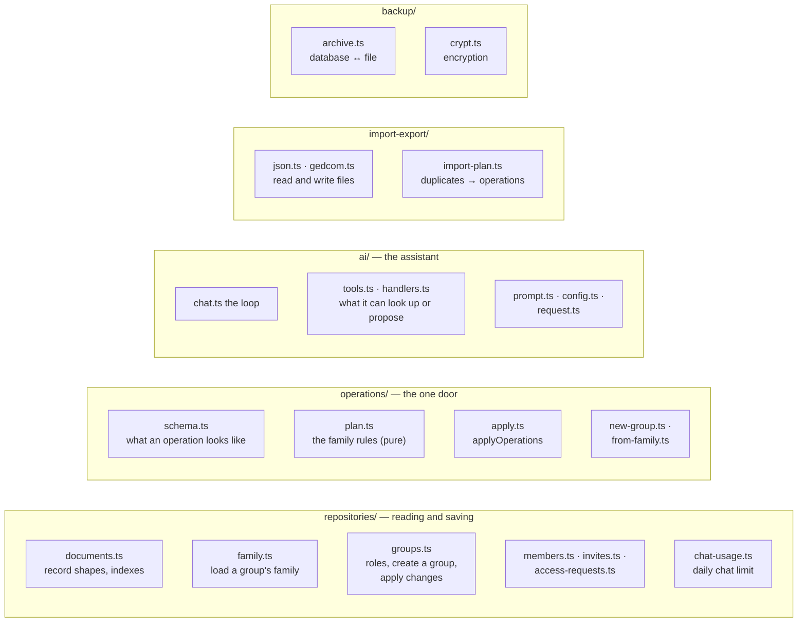

| Folder | In plain words |
|---|---|
| [repositories/](../src/server/repositories/) | Every database read and write, grouped by subject. Every function takes a `groupId`, so one family's data never leaks into another's |
| [operations/](../src/server/operations/) | The single door for changes (Idea 4). `schema.ts` describes the 14 kinds of operation, `plan.ts` checks them against the family's rules without touching the database, `apply.ts` saves the result in one transaction |
| [ai/](../src/server/ai/) | The chat: the instructions given to Claude (`prompt.ts`), the tools it may call (`tools.ts`), what each tool does (`handlers.ts`, read-only lookups and proposals), and the back-and-forth loop (`chat.ts`) |
| [import-export/](../src/server/import-export/) | Converts between the app's family data and files (the app's own JSON, and GEDCOM used by Ancestry, FamilySearch and others). Pure, so the browser can use it too |
| [backup/](../src/server/backup/) | The nightly backup: every collection into one compressed, encrypted file, and restoring it |

---

## 9. What's saved in the database

MongoDB stores **documents** (records that look like JSON) in **collections** (like tables).

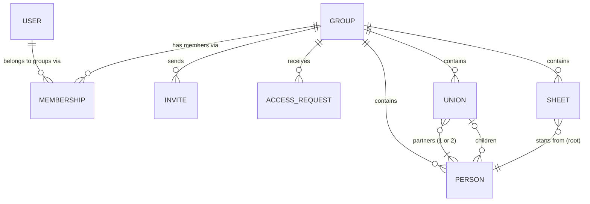

| Collection | What one record is |
|---|---|
| `users`, `sessions`, `accounts`, `verifications` | Signed-in people and their sessions (managed by Better Auth) |
| `groups` | One family (a name) |
| `memberships` | "This user is in this group with this role" |
| `invites` | An invitation sent to an email address |
| `accessRequests` | "Please let me in", sent by someone who opened a link without access |
| `persons` | One person: name, gender, dates, photo id |
| `unions` | One couple (♥): partners, married or divorced, wedding date, children |
| `sheets` | One tab: title, root person, extra people, pinned or not, order |
| `chatUsage` | How many AI messages a user sent today (for the daily limit) |

Here's a tiny family as it's saved (simplified):

```js
// persons
{ _id: "p1", groupId: "g1", name: "Ravi Kumar",  gender: "male",   birthYear: 1980 }
{ _id: "p2", groupId: "g1", name: "Priya Sharma", gender: "female", birthYear: 1983 }
{ _id: "p3", groupId: "g1", name: "Anu Kumar",   gender: "female", birthYear: 2012 }

// unions: the heart joins the parents and lists the children
{ _id: "u1", groupId: "g1", partnerIds: ["p1", "p2"], status: "married",
  marriageYear: 2010, childIds: ["p3"] }

// sheets: only the starting person is stored; who's shown is worked out each time
{ _id: "s1", groupId: "g1", title: "Ravi Kumar's family", rootPersonId: "p1",
  extraPersonIds: [], pinned: true, order: 0 }
```

Two habits worth knowing:

- **Soft delete.** Deleting a person sets `deletedAt` instead of removing the record, so **Undo** can bring them back.
- **Every record carries `groupId`**, and every query filters by it.

There are four databases in the same cluster: `familytree_dev` (your laptop), `familytree_preview` (Vercel's preview builds), `familytree` (the real site), and a throwaway one for each test run.

---

## 10. Follow a click: four journeys through the code

### Journey A: opening a sheet

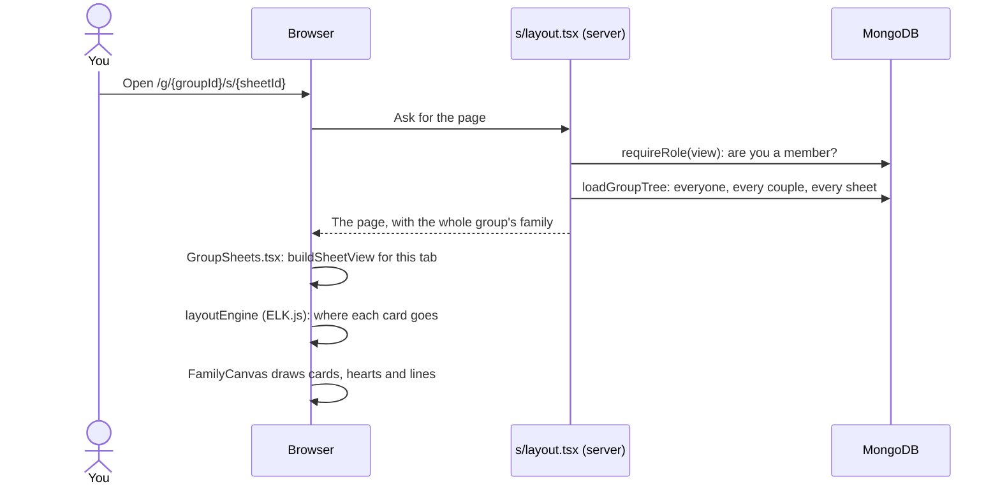

The whole group is loaded once, so switching tabs afterwards is instant: no trip to the server.

### Journey B: adding a child by hand

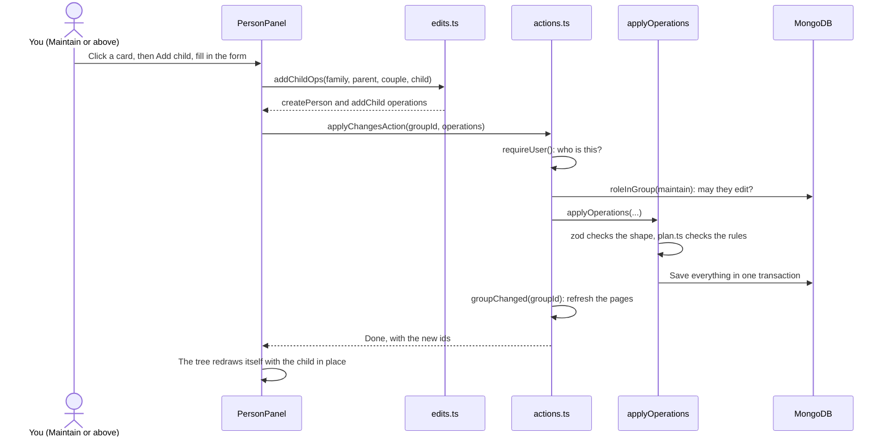

The files involved, in order: [PersonPanel.tsx](../src/components/tree/edit/PersonPanel.tsx) → [edits.ts](../src/tree/edits.ts) → [GroupSheets.tsx](../src/app/g/[groupId]/s/GroupSheets.tsx) (`run`) → [actions.ts](../src/app/g/[groupId]/actions.ts) → [groups.ts](../src/server/repositories/groups.ts) (`applyGroupChanges`) → [apply.ts](../src/server/operations/apply.ts) → [plan.ts](../src/server/operations/plan.ts).

### Journey C: asking the AI

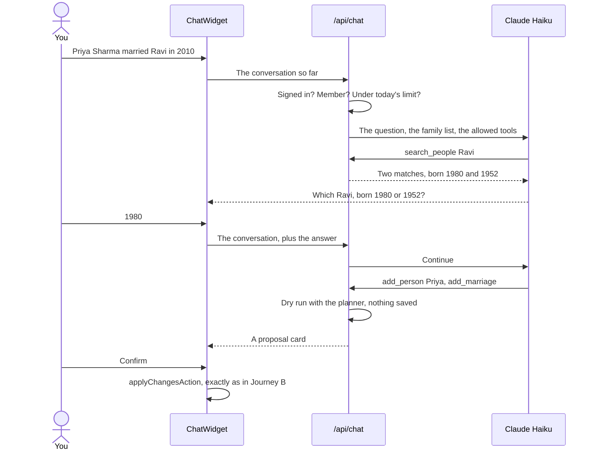

### Journey D: uploading a photo

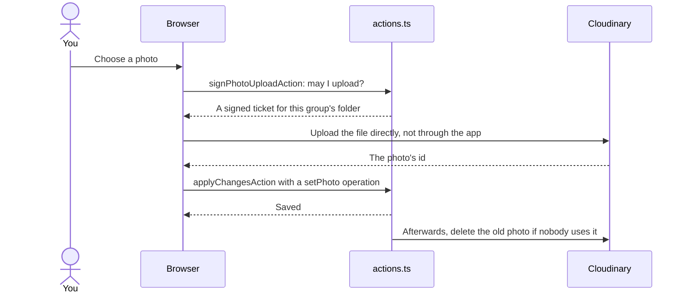

Photos skip the app server, so big files don't hit Vercel's size limits.

---

## 11. Tests: how the project checks itself

There are four kinds of test, from many fast ones to a few slow ones:

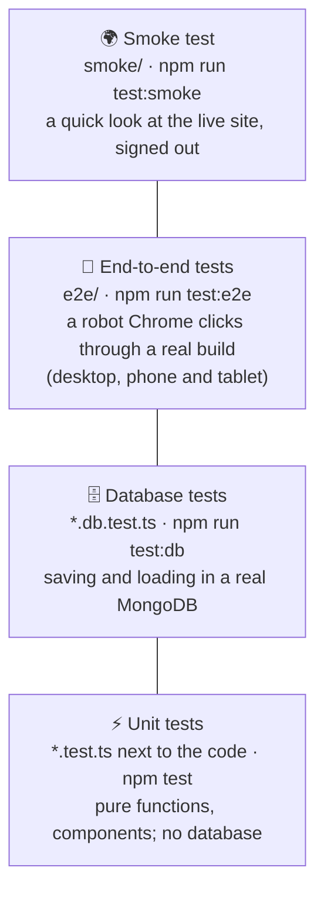

| Kind | Tool | Where | What it checks |
|---|---|---|---|
| Unit | Vitest | `src/**/*.test.ts(x)`, `test/*.test.ts` | Pure logic and components, in milliseconds |
| Database | Vitest | `src/**/*.db.test.ts` | Transactions, permissions and keeping groups apart, in a throwaway database |
| End-to-end | Playwright | [e2e/](../e2e/) | Real user journeys in Chrome against a production build: sign in, edit, chat, photos, phones… |
| Smoke | Playwright | [smoke/](../smoke/) | The live site is up and secure, after every deployment |

The end-to-end tests never reach Google, Cloudinary or Anthropic. They use stand-ins:

- [e2e/fixtures.ts](../e2e/fixtures.ts): `signIn(page, name)` creates a test user and session directly; `sampleGroup` creates a group with the sample family.
- [e2e/cloudinary-stub.mts](../e2e/cloudinary-stub.mts): a pretend Cloudinary.
- [e2e/model-stub.mts](../e2e/model-stub.mts): a pretend Claude that gives scripted answers.

The [test/](../test/) folder holds what the tests share:

| File | What it is |
|---|---|
| [fixtures/cruz-young.ts](../test/fixtures/cruz-young.ts) | The sample family of 36 people that most tests use |
| [fixtures/generated.ts](../test/fixtures/generated.ts) | Builds large made-up families (for speed tests) |
| [planning.ts](../test/planning.ts) | Applies operations to a family in memory, with the real planner, without a database |
| [db.ts](../test/db.ts) | `createTestDatabase()`: a fresh database for each test file |
| [dialogs.ts](../test/dialogs.ts) | Stand-ins for the browser's modal dialogs, which jsdom doesn't have |
| [server-checks.test.ts](../test/server-checks.test.ts) | Reads every server action and API route and fails if one forgets to check who's calling |

---

## 12. Scripts, automation and deployment

### Commands you'll use

| Command | What it does |
|---|---|
| `npm run dev` | Starts the app on your computer at http://localhost:3000 |
| `npm test` | Runs the unit tests |
| `npm run lint` / `npm run typecheck` | Checks code style / checks the TypeScript types |
| `npm run build` | Builds the app the way Vercel does |
| `npm run test:e2e` | Builds, then runs the robot-browser tests |
| `npm run seed` | Puts the sample family into your database (view it at `/dev/tree/db`) |
| `npm run images` | Makes the icons, the link-preview picture, GitHub's social preview and the landing page's pictures |

### `scripts/`

| Script | What it does |
|---|---|
| [db-ping.mts](../scripts/db-ping.mts) | Checks the database connection works |
| [db-setup.mts](../scripts/db-setup.mts) | Creates the database indexes (safe to run again) |
| [db-indexes.mts](../scripts/db-indexes.mts) | Lists each collection's indexes and counts |
| [seed.mts](../scripts/seed.mts) | Adds the sample family |
| [ai-live.mts](../scripts/ai-live.mts) | One real conversation with Claude (costs under a cent) |
| [backup.mts](../scripts/backup.mts), [restore.mts](../scripts/restore.mts) | Makes an encrypted backup; restores one |
| [site-images.mts](../scripts/site-images.mts) | `npm run images`: draws the site's pictures from [icon.svg](../src/app/icon.svg) and the screenshots in `docs/screenshots/` |

### From a change to the live site

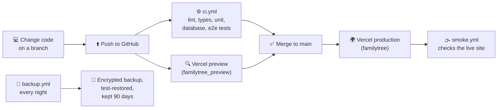

| Workflow | When it runs |
|---|---|
| [ci.yml](../.github/workflows/ci.yml) | Every push: all checks and tests |
| [smoke.yml](../.github/workflows/smoke.yml) | After each production deployment |
| [backup.yml](../.github/workflows/backup.yml) | Every night |

---

## 13. Settings files at the root

| File | What it's for |
|---|---|
| [package.json](../package.json) | The libraries the app uses and the `npm run …` commands |
| `package-lock.json` | The exact version of every library, so every install is identical |
| `.npmrc` | npm's settings for this project |
| [next.config.ts](../next.config.ts) | Next.js settings: Tailwind, security headers, upload size for imports |
| [tsconfig.json](../tsconfig.json) | TypeScript settings, and the `@/` and `@test/` shortcuts |
| [eslint.config.mjs](../eslint.config.mjs) | Code style rules (`npm run lint`) |
| [vitest.config.mts](../vitest.config.mts), [vitest.db.config.mts](../vitest.db.config.mts) | Settings for unit tests and database tests |
| [playwright.config.ts](../playwright.config.ts), [playwright.smoke.config.ts](../playwright.smoke.config.ts) | Settings for end-to-end tests and the smoke test |
| [vercel.json](../vercel.json) | Tells Vercel this is a Next.js app |
| [.env.example](../.env.example) | Every setting and secret the app needs; copy it to `.env.local` and fill it in (never commit `.env.local`) |
| [AGENTS.md](../AGENTS.md), [.claude/CLAUDE.md](../.claude/CLAUDE.md) | Instructions for AI coding assistants working on this repository |
| [README.md](../README.md), [LICENSE](../LICENSE) | The front page, and the MIT licence |

---

## 14. Where to start reading

A suggested order for your first afternoon:

```mermaid
flowchart TB
    r1["1. README.md<br/>what the app does"] --> r2["2. src/tree/types.ts<br/>Person, Union, Sheet"]
    r2 --> r3["3. test/fixtures/cruz-young.ts<br/>a real example family"]
    r3 --> r4["4. src/tree/sheet-view.ts<br/>who goes on a sheet"]
    r4 --> r5["5. src/app/g/[groupId]/s/<br/>layout.tsx then GroupSheets.tsx"]
    r5 --> r6["6. src/components/tree/edit/PersonPanel.tsx<br/>and src/tree/edits.ts"]
    r6 --> r7["7. src/app/g/[groupId]/actions.ts<br/>then src/server/operations/"]
    r7 --> r8["8. src/server/permissions.ts<br/>and roles.ts"]
```

Then pick what interests you:

| I want to… | Look at… |
|---|---|
| Change how a person's card looks | [PersonNode.tsx](../src/components/tree/PersonNode.tsx), [PersonPhoto.tsx](../src/components/tree/PersonPhoto.tsx) |
| Change who appears on a sheet | [sheet-view.ts](../src/tree/sheet-view.ts) and its tests |
| Change where cards are placed | [src/tree/layout/](../src/tree/layout/) |
| Add a new kind of edit | [edits.ts](../src/tree/edits.ts) (builder), [schema.ts](../src/server/operations/schema.ts) and [plan.ts](../src/server/operations/plan.ts) if it needs a new operation or rule, then a button in [PersonPanel.tsx](../src/components/tree/edit/PersonPanel.tsx) |
| Add a field to a person | [types.ts](../src/tree/types.ts), [schema.ts](../src/server/operations/schema.ts), [family.ts](../src/server/repositories/family.ts), the form, and the import/export converters |
| Teach the AI something new | [src/server/ai/tools.ts](../src/server/ai/tools.ts) and [handlers.ts](../src/server/ai/handlers.ts) |
| Change who may do what | [roles.ts](../src/server/roles.ts) |
| Add a new page | A folder under [src/app/](../src/app/) with a `page.tsx`; if signed-out visitors may see it, add it to `PUBLIC_PATHS` in [proxy-rules.ts](../src/server/proxy-rules.ts) (and, for search engines, to [site.ts](../src/server/site.ts)'s sitemap) |
| Change the landing page's words | [landing/content.ts](../src/components/landing/content.ts) (title, description, questions) and the parts in [components/landing/](../src/components/landing/) |
| Change the icon or the link-preview picture | [icon.svg](../src/app/icon.svg) or the screenshots in `docs/screenshots/`, then `npm run images` |
| Add a tool button above the tree | [GroupSheets.tsx](../src/app/g/[groupId]/s/GroupSheets.tsx) (`trailing` for computers, `menuItems` for phones and tablets) |

For the full rules behind any of this, see [ARCHITECTURE.md](ARCHITECTURE.md); for the history of why things are the way they are, see the notes in [BUILD_PLAN.md](BUILD_PLAN.md).

---

## 15. Glossary

| Word | Meaning |
|---|---|
| **Next.js** | A framework for building websites with React; here it handles both the pages and the server code |
| **React** | A library for building screens out of reusable pieces called components |
| **Component** | A reusable piece of screen, written as a function that returns what to draw (`.tsx` files) |
| **Server component** | A component that runs on the server and sends finished HTML; it can read the database directly |
| **Client component** | A component that runs in the browser so it can react to clicks; its file starts with `"use client"` |
| **Server action** | A server function the browser can call like a normal function; its file starts with `"use server"` |
| **Route handler** | An API endpoint (`route.ts`) that answers with data instead of a page |
| **Hydration** | The moment the browser makes a server-drawn page clickable |
| **TypeScript** | JavaScript with types, so mistakes are caught before the code runs |
| **Tailwind CSS** | Styling with short class names in the HTML, like `bg-white` or `dark:bg-zinc-900` |
| **React Flow** | The library that draws the tree canvas with zoom and pan |
| **ELK.js** | A library that works out where to place boxes and lines in a diagram |
| **d3-force** | A library that arranges circles by simulating pushing and pulling forces (the Network view) |
| **zod** | A library that checks that data has the expected shape |
| **MongoDB** | The database: it stores documents (JSON-like records) in collections |
| **ObjectId** | MongoDB's 24-character id for a record |
| **Index** | A lookup table that makes database searches fast |
| **Transaction** | A group of database writes that all succeed or all fail together |
| **Soft delete** | Marking a record as deleted (`deletedAt`) instead of removing it, so it can be restored |
| **Better Auth** | The library that handles Google sign-in and sessions |
| **Session** | Proof that you're signed in, kept in a cookie |
| **Pure function** | A function with no side effects: the same input always gives the same output |
| **Operation** | One small change instruction, like `createPerson` or `addChild` |
| **Union** | A couple (the ♥) with its children; one partner alone is a single parent |
| **Sheet** | A tab showing part of the family, starting from a root person |
| **GEDCOM** | The standard file format for family trees, used by Ancestry and others |
| **Cloudinary** | The service that stores photos and crops them around faces |
| **CSP (Content Security Policy)** | Rules sent with each page that tell the browser what it may load, to block attacks |
| **Vitest** | The tool that runs unit and database tests |
| **Playwright** | The tool that drives a real browser for end-to-end tests |
| **CI (continuous integration)** | Running all the tests automatically on every push (GitHub Actions here) |
| **Vercel** | The hosting service that builds and runs the app |
